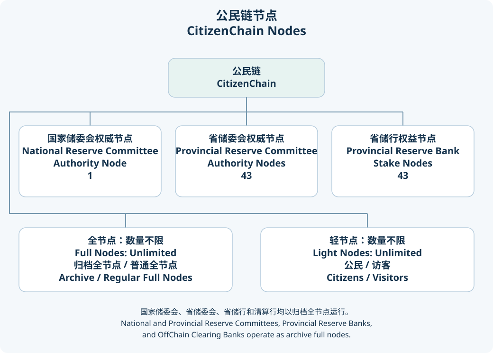
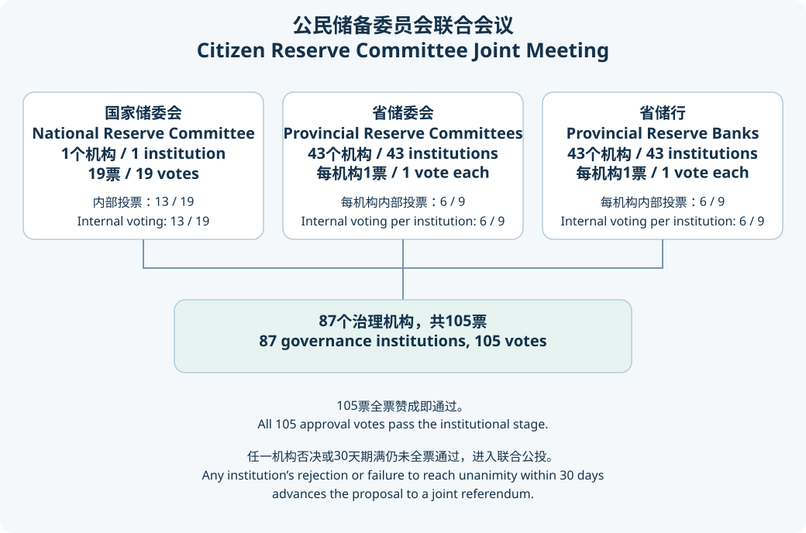

# **《公民链白皮书》**<br><span class="whitepaper-title-en">CitizenChain Whitepaper</span>

# 目录<br><span class="whitepaper-heading-en">Table of Contents</span>

- <details>
  <summary>1. 总则</summary>

  [1.1. 目的](#11目的)
  [1.2. 名称](#12名称)
  [1.3. 发行方](#13发行方)
  [1.4. 发行量](#14发行量)
  [1.5. 创世理念](#15创世理念)
  [1.6. 去中心化](#16去中心化)
  </details>

- <details>
  <summary>2. 节点设置</summary>

  [2.1. 节点概览](#21节点概览)
  [2.2. 国家储委会权威节点](#22国家储委会权威节点)
  [2.3. 省储委会权威节点](#23省储委会权威节点)
  [2.4. 省储行权益节点](#24省储行权益节点)
  [2.5. 全节点](#25全节点)
  [2.6. 轻节点：公民/访客](#26轻节点公民访客)
  </details>

- <details>
  <summary>3. 发行与销毁</summary>

  [3.1. 创世发行](#31创世发行)
  [3.2. 省储行创立发行与质押利息](#32省储行创立发行与质押利息)
  [3.3. 全节点发行](#33全节点发行)
  [3.4. 公民发行](#34公民发行)
  [3.5. 两和基金发行](#35两和基金发行)
  [3.6. 决议发行](#36决议发行)
  [3.7. 销毁](#37销毁)
  </details>

- <details>
  <summary>4. 技术架构</summary>

  [4.1. 主体架构](#41主体架构)
  [4.2. 公民协议](#42公民协议)
  [4.3. 节点程序](#43节点程序)
  [4.4. 链上中国](#44链上中国)
  [4.5. 以太坊兼容](#45以太坊兼容)
  </details>

- <details>
  <summary>5. 公民协议</summary>

  [5.1. 创世模块](#51创世模块)
  [5.2. 协议基础库](#52协议基础库)
  [5.3. 投票引擎](#53投票引擎)
  [5.3.1. 内部投票](#531内部投票)
  [5.3.2. 联合投票](#532联合投票)
  [5.3.3. 立法投票](#533立法投票)
  [5.3.4. 选举投票](#534选举投票)
  [5.4. 治理模组](#54治理模组)
  [5.5. 管理员模组](#55管理员模组)
  [5.5.1. 个人多签管理员](#551个人多签管理员)
  [5.5.2. 私权机构管理员](#552私权机构管理员)
  [5.5.3. 公权机构管理员](#553公权机构管理员)
  [5.6. 公权业务模组](#56公权业务模组)
  [5.6.1. 立法院模块](#561立法院模块)
  [5.6.2. 公民选举模块](#562公民选举模块)
  [5.7. 实体模组](#57实体模组)
  [5.7.1. 个人多签](#571个人多签)
  [5.7.2. 私权机构](#572私权机构)
  [5.7.3. 公权机构](#573公权机构)
  [5.8. 发行模组](#58发行模组)
  [5.9. 交易模组](#59交易模组)
  [5.10. 其他模组](#510其他模组)
  [5.10.1. 链上公民身份](#5101链上公民身份)
  [5.10.2. 工作量难度模块](#5102工作量难度模块)
  [5.10.3. 地址变更上链](#5103地址变更上链)
  [5.10.4. 广场内容与会员订阅](#5104广场内容与会员订阅)
  </details>

- <details>
  <summary>6. 节点程序</summary>

  [6.1. 节点程序简介](#61节点程序简介)
  [6.2. 宪法守卫](#62宪法守卫)
  [6.3. 节点守卫](#63节点守卫)
  [6.4. 治理机构](#64治理机构)
  [6.5. 链下清算行](#65链下清算行)
  </details>

- <details>
  <summary>7. 链上中国</summary>

  [7.1. 简介](#71简介)
  [7.2. 平台框架](#72平台框架)
  [7.3. 注册局](#73注册局)
  [7.4. 立法院](#74立法院)
  [7.5. 司法院](#75司法院)
  [7.6. 私权机构](#76私权机构)
  </details>

- <details>
  <summary>8. 公民</summary>
  </details>

- <details>
  <summary>9. 公民钱包</summary>
  </details>

- <details>
  <summary>10. 公民软件包</summary>
  </details>

****
# 1.总则<br><span class="whitepaper-heading-en">1. General Principles</span>

## 1.1.目的<br><span class="whitepaper-heading-en">1.1. Purpose</span>

* 基于区块链技术以推动“公民建国运动”的主权区块链系统，创立公民链，采取去中心化民运，以建立自由民主的中华民族联邦共和国；<br><span class="whitepaper-en">CitizenChain is a sovereign blockchain system founded on blockchain technology to advance the Citizen Nation-Building Movement. It adopts a decentralized democratic movement model to establish a free and democratic Federal Republic of the Chinese Nation.</span>
* 公民链是一条不受任何机构掌控的主权区块链，一个所有人都能自由使用的法定数字货币系统，一条所有中华民族联邦共和国公民都能参与投票的区块链；<br><span class="whitepaper-en">CitizenChain is a sovereign blockchain not controlled by any institution, a legal digital-currency system freely usable by everyone, and a blockchain on which all citizens of the Federal Republic of the Chinese Nation may participate in voting.</span>
* 公民链依据《公民宪法》和《公民链白皮书》发行法定数字货币公民币，公民币是中华民族联邦共和国法定数字货币，是公民链治理货币；<br><span class="whitepaper-en">CitizenChain issues the legal digital currency GMB pursuant to the Citizen Constitution and the CitizenChain Whitepaper. GMB is the legal digital currency of the Federal Republic of the Chinese Nation and the governance currency of CitizenChain.</span>

## 1.2.名称<br><span class="whitepaper-heading-en">1.2. Name</span>

* 名称：公民链（英文：CitizenChain），原生数字货币：公民币，符号：GMB；<br><span class="whitepaper-en">Name: 公民链, English name: CitizenChain. Native digital currency: GMB. Symbol: GMB.</span>
* 单位：常用单位：元（YUAN），小数单位：分（FEN），元最小为1元，分最小为1分，100分等于1元，统一使用分为系统计算单位，使用元为前端展示单位。<br><span class="whitepaper-en">Units: the common unit is yuan (YUAN), and the fractional unit is fen (FEN). The minimum yuan unit is 1 yuan, the minimum fen unit is 1 fen, and 100 fen equals 1 yuan. The system uniformly uses fen as the calculation unit and yuan as the frontend display unit.</span>

* 本白皮书中的中文名称、英文名称和系统名称均以本节为统一约定，全文统一使用本节名称、缩写和系统称谓。<br><span class="whitepaper-en">The Chinese names, English names, and system names in this whitepaper are uniformly defined in this section. The entire whitepaper uses the names, abbreviations, and system terms defined here.</span>

```
|         中文术语        |                 英文/系统名称                  |                         说明                         |
|:----------------------:|:---------------------------------------------:|:---------------------------------------------------:|
| 公民主义                | Citizenism                                    | 国家根本政治理念，由民治、民主、民权、民生、民族构成 |
| 公民链                  | CitizenChain                                  | 主权区块链系统                                      |
| 公民币                  | GMB                                           | 公民链原生法定数字货币和治理货币                    |
| 公民钱包                | CitizenWallet                                 | 离线冷钱包软件                                      |
| 公民                    | CitizenApp                                    | 公民链轻节点、热钱包、投票交互和去中心化通信软件      |
| 公民协议 | Runtime | 公民链运行时协议，统一执行链上规则 |
| 节点程序 | Node | 公民链节点程序及桌面端 |
| 链上中国平台             | OnChina                                       | 公民链节点内置的机构业务平台，包含注册局、立法院、司法院和私权机构四个模块 |
| 注册局                  | Registry                                      | 链上中国平台中的注册业务角色，包含联邦注册局和市注册局，用于注册公民、公权机构、私权机构和机构管理员 |
| 身份识别码               | CID                                           | 注册局签发的统一身份号码，是公民身份、自然人和机构的身份编号字段 |
| 清算行                  | clearing bank                                 | 链下清算行的简称，业务尚未开放 |
| 投票资格                | voting eligibility                            | 公民是否可参与投票的资格状态，由注册局根据公民护照状态判定 |
| 投票范围                | voting scope                                  | 公民按居住地参与投票的地域范围                       |
| 参选范围                | candidacy scope                               | 公民按出生地参与被选举或出生地类选举的地域范围        |
```

## 1.3.发行方<br><span class="whitepaper-heading-en">1.3. Issuer</span>

* 发行方为中华民族联邦共和国公民储备委员会联合会议；<br><span class="whitepaper-en">The issuer is the Citizen Reserve Committee Joint Meeting of the Federal Republic of the Chinese Nation.</span>
* 依据《公民宪法》储委会体系由1个国家储委会、43个省储委会和43个省储行组成。<br><span class="whitepaper-en">Pursuant to the Citizen Constitution, the Reserve Committee system consists of one National Reserve Committee, 43 Provincial Reserve Committees, and 43 Provincial Reserve Banks.</span>

## 1.4.发行量<br><span class="whitepaper-heading-en">1.4. Issuance Amount</span>

```
|     发行类型    |               发行金额/上限           |          释放/流通状态          |               执行模块/触发                |              账户归属/边界              |
|:--------------:|:-----------------------------------:|:----------------------------:|:----------------------------------------:|:--------------------------------------:|
|  创世发行       |  144,349,737,800.00元 (1443.50亿)    |   创世一次性流通               |  创世状态写入                             |  六个指定账户共700亿元、国家储委会19个创世管理员账户各1000万元，余额写入国家储委会主账户 |
|  省储行创立发行  |  144,349,737,800.00元 (1443.50亿)    |   永久质押                    |  创世状态写入+省储行常量                   |  43个省储行无私钥永久质押账户              |
|  省储行质押利息  |    72,896,617,589.00元 (728.97亿)    |   100年逐年释放               |  prbbankissue模块，每87,600块结算一次 |  43个省储行多签治理账户                   |
|  全节点发行     |    99,989,990,001.00元 (999.90亿)    |   第1至9,999,999块逐块释放      |  fullnodeissue模块，出块时触发          |  出块矿工账户或其绑定奖励钱包              |
|  公民发行       | 1,571,981,633,622.00元 (1.57万亿)    |   首次链上正式身份登记后逐个释放   |  citizenissue模块，首次投票或参选身份登记成功回调触发 |  首次完成投票或参选身份登记的公民账户，已有身份升级不重复发行 |
|  两和基金发行    |  195,818,501,966.00元 (1958.19亿)    |   创世一次性流通               |  创世状态HE_FUND_ISSUANCE写入              |  国家储委会两和基金账户                       |
|  已确定发行合计  | 2,229,386,218,778.00元 (2.23万亿)    |   按上述规则释放或质押           |  固定发行合计，不含决议发行                  |  不含后续治理决议新增发行                  |
|  决议发行       |  按单个提案金额执行，受链上限额约束       |   提案通过后一次性执行           |  resolutionissue模块+联合投票回调       |  仅能发行至链上允许的合法收款账户集合        |
```

<span class="whitepaper-en">Issuance schedule:</span>

```
|       Issuance Type        |              Amount / Cap             |              Release / Circulation Status              |                 Execution Module / Trigger                |                 Account Ownership / Boundary                |
|:--------------------------:|:------------------------------------:|:------------------------------------------------------:|:--------------------------------------------------------:|:----------------------------------------------------------:|
| genesis           | 144,349,737,800.00 yuan (144.350 billion) | One-time circulation at genesis | Written into genesis state | Six designated accounts total 70.0 billion yuan; the 19 NRC genesis administrator accounts 10,000,000 yuan each; the balance to the NRC main account |
| prbbankissue | 144,349,737,800.00 yuan (144.350 billion) | Permanently staked | Genesis state plus provincial reserve bank constants | 43 provincial reserve bank staking accounts without private keys |
| prbbankissue | 72,896,617,589.00 yuan (72.897 billion) | Released annually over 100 years | prbbankissue module, once every 87,600 blocks | 43 provincial reserve bank multisig governance accounts |
| fullnodeissue         | 99,989,990,001.00 yuan (99.990 billion) | Released block by block from block 1 through block 9,999,999 | fullnodeissue module, triggered by block production | Block author account or its bound reward wallet |
| citizenissue | 1,571,981,633,622.00 yuan (1.572 trillion) | Released one by one after first formal on-chain identity registration | citizenissue module, triggered by the first voting- or candidate-identity registration callback | Citizen accounts with first voting- or candidate-identity registration; later upgrades do not issue again |
| Reconciliation Fund issuance | 195,818,501,966.00 yuan (195.819 billion) | One-time circulation at genesis | HE_FUND_ISSUANCE written into genesis state | National Reserve Committee Reconciliation Fund account |
| Determined issuance total | 2,229,386,218,778.00 yuan (2.229 trillion) | Released or staked under the rules above | Fixed issuance total, excluding resolution issuance | Excludes later issuance added by governance resolution |
| resolutionissue        | Executed by proposal amount and constrained by on-chain limits | One-time execution after proposal approval | resolutionissue module plus jointvote callback | May issue only to the on-chain allowed recipient set |
```

* 上述发行金额以元为展示单位，链上以分为计算单位；固定发行合计为2,229,386,218,778.00元，不包含后续决议发行。以亿、万亿、billion或trillion表示的简述均为近似值，按所显示的小数位四舍五入，精确金额以元列为准。<br><span class="whitepaper-en">The amounts above are displayed in yuan while on-chain calculation uses fen. The fixed determined issuance total is 2,229,386,218,778.00 yuan, excluding later resolution issuance. Summaries expressed in 亿, 万亿, billion, or trillion are approximate values rounded to the displayed decimal places; the yuan amounts are authoritative.</span>
* 决议发行不是创世固定发行的一部分，只能在储委会联合会议决议、链上联合投票和发行模块限额校验均通过后执行；交易手续费不属于发行，销毁会减少链上总供应量。<br><span class="whitepaper-en">Resolution issuance is not part of fixed genesis issuance. It may execute only after resolution of the Citizen Reserve Committee Joint Meeting, on-chain joint voting, and issuance-module limit checks all pass. Transaction fees are not issuance, and destruction reduces total on-chain supply.</span>

## 1.5.创世理念<br><span class="whitepaper-heading-en">1.5. Genesis Philosophy</span>

* 公民宣言：先有人类后有国家，是公民建立国家，国家是公民的国家，是公民治理国家，而不是国家统治公民，公民没有爱国的义务；国家政权的建立其基本原则是保护公民的生命权、自由权、财产权、反抗压迫权和选举与被选举权不受任何的非法侵犯，当国家政权无法保证这一基本原则时，公民有权有义务推翻这个政权，建立一个以保障公民生命权、自由权、财产权、反抗压迫权和选举与被选举权为基本原则的政权。<br><span class="whitepaper-en">Citizen Declaration: humanity precedes the state. Citizens establish the state; the state belongs to citizens; citizens govern the state; the state does not rule over citizens; and citizens have no obligation of patriotism. The founding principle of state power is to protect citizens' rights to life, liberty, property, resistance against oppression, and to vote and stand for election from any unlawful infringement. When state power cannot guarantee this basic principle, citizens have both the right and the duty to overthrow that regime and establish a regime whose founding principle is the protection of citizens' rights to life, liberty, property, resistance against oppression, and to vote and stand for election.</span>
* 国家名称与公民主义：中华民族联邦共和国国家名称是基于中华各民族悠久历史与璀璨文化的沉淀，全称为：中华民族联邦共和国，简称为：中华联邦；中华民族联邦共和国是致力于推行“公民主义”的———「公民治理国家（民治）、实行民主共和（民主）、保障公民权利（民权）、建设民生社会（民生）、复兴民族文化（民族）」———联邦制共和国。<br><span class="whitepaper-en">State name and Citizenism: the state name Federal Republic of the Chinese Nation is rooted in the long history and splendid cultures of the various ethnic groups of the Chinese Nation. Its full name is the Federal Republic of the Chinese Nation, and its abbreviated name is the Chinese Federation. The Federal Republic of the Chinese Nation is a federal republic committed to advancing “Citizenism”: the governance of the State by citizens (mínzhì), the practice of democratic republicanism (mínzhǔ), the protection of citizens’ rights (mínquán), the building of a society of citizens’ livelihood (mínshēng), and the revival of ethnic cultures (mínzú).</span>

## 1.6.去中心化<br><span class="whitepaper-heading-en">1.6. Decentralization</span>

* 公民链及其附属软件的独立自有代码采用MIT开源许可，并在GitHub上开放源代码；上游组件、依赖及其衍生修改保留各自许可，组合分发须遵守所有适用条款，以支持开发者开发和部署区块链应用；<br><span class="whitepaper-en">Independently authored code in CitizenChain and its affiliated software uses the MIT license and is published on GitHub. Upstream components, dependencies, and derived modifications retain their respective licenses, and combined distributions must comply with all applicable terms. This supports developers in building and deploying blockchain applications.</span>
* 公民链坚持去中心化，任何个人、任何组织都可以加入成为去中心化的节点（全节点、轻节点），及参与公民链的治理与技术开发。<br><span class="whitepaper-en">CitizenChain upholds decentralization. Any individual or organization may join as a decentralized node, including a full node or light node, and may participate in CitizenChain governance and technical development.</span>

****
# 2.节点设置<br><span class="whitepaper-heading-en">2. Node Configuration</span>

## 2.1.节点概览<br><span class="whitepaper-heading-en">2.1. Node Overview</span>

```
|  节点  |  国家储委会权威节点  |   初始省储委会权威节点  |  初始省储行权益节点  |     全节点     |          轻节点       |
|:-----:|:--------------:|:------------------:|:-----------------:|:-------------:|:--------------------:|
|  数量  |       1个      |        43个        |        43个        |      无限     |      公民/访客：无限    |
|  功能  | 国家级治理与最终性 |  省级治理与最终性投票   | 永久质押与省储行治理  | PoW出块、链数据保存、本地服务、可选链上中国；清算行业务待开放 | 钱包、公民身份确认、投票、通信 |
```

<span class="whitepaper-en">Node overview:</span>

```
| Node | National Reserve Committee Authority Node | Initial Provincial Reserve Committee Authority Nodes | Initial Provincial Reserve Bank Stake Nodes | Full Nodes | Light Nodes |
|:----:|:-----------------------------------------:|:----------------------------------------------------:|:------------------------------------------:|:----------:|:-----------:|
| Quantity | 1 | 43 | 43 | Unlimited | Citizens / visitors: unlimited |
| Function | National governance and finality | Provincial governance and finality voting | Permanent staking and provincial reserve bank governance | PoW block production, chain-data storage, local services, optional OnChina; clearing services not yet available | Wallet, citizen identity, voting, communication |
```



## 2.2.国家储委会权威节点<br><span class="whitepaper-heading-en">2.2. National Reserve Committee Authority Node</span>

* 有1个国家储委会权威节点，不能增删改，拥有19个管理员，分别对应国家储委会的19个委员；<br><span class="whitepaper-en">There is one National Reserve Committee authority node. It cannot be added, deleted, or modified. It has 19 administrators, corresponding respectively to the 19 members of the National Reserve Committee.</span>
* 国家储委会拥有19票投票权和4个多签名治理账户（主账户+费用账户+安全基金账户+两和基金账户），采用N=19，T≥13签名，通过则19票同时生效，反之则同时否决；<br><span class="whitepaper-en">The National Reserve Committee has 19 votes and four multisignature governance accounts: a main account, a fee account, a Safety Fund account, and a Reconciliation Fund account. It uses N=19 and threshold T>=13 signatures. If approved, all 19 votes take effect simultaneously; otherwise, they are all rejected simultaneously.</span>
* 国家储委会拥有发起“发行数字公民币、销毁数字公民币、协议升级、更换国家储委会多签管理员、增删改新省储委会/新省储行”等提案权，承担数据归档和节点引导；<br><span class="whitepaper-en">The National Reserve Committee has the authority to initiate proposals including issuing digital GMB, destroying digital GMB, protocol upgrades, replacing National Reserve Committee multisig administrators, and adding, deleting, or modifying new Provincial Reserve Committees or Provincial Reserve Banks. It also undertakes data archiving and node bootstrapping.</span>
* 国家储委会和省储委会负责区块的最终性确认，由一套最终性验证密钥负责投票，此投票仅属于区块的最终性确认投票，投票由国家储委会1票+43个省储委会每省1票=44票，大于等于30票即生成确定性最终性；<br><span class="whitepaper-en">The National Reserve Committee and Provincial Reserve Committees are responsible for block finality confirmation. A set of finality validation keys is responsible for voting, and this vote is only for block finality confirmation. The vote consists of one National Reserve Committee vote plus one vote from each of the 43 Provincial Reserve Committees, for a total of 44 votes. At least 30 votes generate deterministic finality.</span>
* 国家储委会费用账户用于接收10%的链上交易手续费，且只能往主账户转账；安全基金账户用于接收10%的链上交易手续费，安全基金用于赔付用户因区块链技术原因造成的损失。<br><span class="whitepaper-en">The National Reserve Committee fee account receives 10% of on-chain transaction fees and may only transfer funds to the main account. The Safety Fund account receives 10% of on-chain transaction fees, and the Safety Fund is used to compensate users for losses caused by blockchain technology reasons.</span>

## 2.3.省储委会权威节点<br><span class="whitepaper-heading-en">2.3. Provincial Reserve Committee Authority Nodes</span>

* 初始43个省，每省1个省储委会权威节点，初始权威节点不能增删改，每个节点拥有9个管理员，分别对应省储委会的9个委员；<br><span class="whitepaper-en">There are initially 43 provinces, each with one Provincial Reserve Committee authority node. These initial authority nodes cannot be added, deleted, or modified. Each node has nine administrators, corresponding respectively to the nine members of the Provincial Reserve Committee.</span>
* 每个省储委会拥有1票投票权和2个多签名治理账户（主账户+费用账户），采用N=9，T≥6签名，签名通过则生效，反之则否决；<br><span class="whitepaper-en">Each Provincial Reserve Committee has one vote and two multisignature governance accounts: a main account and a fee account. It uses N=9 and threshold T>=6 signatures. If the signatures pass, the decision takes effect; otherwise, it is rejected.</span>
* 省储委会拥有发起“销毁数字公民币、更换省储委会多签管理员、提案发行”等提案权，承担数据归档、节点引导和区块最终性投票。<br><span class="whitepaper-en">A Provincial Reserve Committee has the authority to initiate proposals including destroying digital GMB, replacing Provincial Reserve Committee multisig administrators, and proposing issuance. It undertakes data archiving, node bootstrapping, and block finality voting.</span>

## 2.4.省储行权益节点<br><span class="whitepaper-heading-en">2.4. Provincial Reserve Bank Stake Nodes</span>

* 初始43个省，每省1个省储行权益节点，初始权益节点不能增删改，每个节点拥有9个管理员，分别对应省储行的9个董事会成员；<br><span class="whitepaper-en">There are initially 43 provinces, each with one Provincial Reserve Bank stake node. These initial stake nodes cannot be added, deleted, or modified. Each node has nine administrators, corresponding respectively to the nine board members of the Provincial Reserve Bank.</span>
* 每个省储行拥有1票投票权和2个多签名治理账户（主账户+费用账户），采用N=9，T≥6签名，签名通过则生效，反之则否决；<br><span class="whitepaper-en">Each Provincial Reserve Bank has one vote and two multisignature governance accounts: a main account and a fee account. It uses N=9 and threshold T>=6 signatures. If the signatures pass, the decision takes effect; otherwise, it is rejected.</span>
* 省储行费用账户是省储行自身的机构费用账户；链下清算设计由符合资格的已注册清算行全节点承担，当前清算业务尚未对外开放；<br><span class="whitepaper-en">The Provincial Reserve Bank fee account is its own institutional fee account. Off-chain clearing is designed for eligible registered clearing-bank full nodes; these clearing services are not yet publicly available.</span>
* 每个省储行拥有1个永久质押账户，永久质押账户只能接收数字公民币，用于永久质押省储行创立发行的数字公民币；<br><span class="whitepaper-en">Each Provincial Reserve Bank has one permanent staking account. The staking account may only receive digital GMB and is used to permanently stake the digital GMB issued at the founding of the Provincial Reserve Bank.</span>
* 省储行拥有发起“销毁数字公民币、更换省储行多签管理员”等内部治理提案权，并在联合投票中拥有省储行票权，承担数据归档和节点引导。<br><span class="whitepaper-en">A Provincial Reserve Bank has the authority to initiate internal-governance proposals including destroying digital GMB and replacing Provincial Reserve Bank multisig administrators. It also holds Provincial Reserve Bank voting power in joint votes and undertakes data archiving and node bootstrapping.</span>

## 2.5.全节点<br><span class="whitepaper-heading-en">2.5. Full Nodes</span>

* 全节点是链同步、交易验证和新块铸块节点，按归档或普通模式保存链数据；链上中国平台和节能能力是可按需打开或关闭的本地节点能力；新区块特指除创世区块以外的所有区块，采用PoW共识机制获得铸块权；<br><span class="whitepaper-en">Full nodes are chain-synchronization, transaction-validation, and new-block minting nodes. They store chain data in archive or regular mode; the OnChina platform and energy-saving capability are local node capabilities that can be enabled or disabled as needed. New blocks refer to all blocks other than the genesis block. Full nodes obtain block-minting rights through the PoW consensus mechanism.</span>
* 全节点数量不限，部署运行citizenchain（中文：公民链）的即全节点，任何组织、任何人均可下载安装节点软件成为全节点，全节点只分为归档全节点和普通全节点两种模式，默认启动为归档全节点模式；<br><span class="whitepaper-en">The number of full nodes is unlimited. Any deployment that runs citizenchain (Chinese: 公民链) is a full node. Any organization or individual may download and install the node software to become a full node. Full nodes have only two modes: archive full node and regular full node. The default startup mode is archive full node.</span>
* 清算行不是新的机构类型，而是全节点的预留链下清算角色。资格限定为私法人股份公司（SFGF），以及父级为该类股份公司的非法人分支机构（UNIN）；按设计还须完成链上机构登记和清算行节点声明。当前清算业务入口尚未开放。<br><span class="whitepaper-en">A clearing bank is a planned off-chain clearing role of a full node, rather than a new institution type. Eligibility is limited to private joint-stock companies (SFGF) and their unincorporated branches (UNIN). The design also requires on-chain institution registration and a clearing-bank node declaration. Clearing business entry points are not yet available.</span>
* 按预留设计，清算行节点须绑定机构身份、节点 PeerId 和可访问的 RPC 端点；用户存款由独立清算账户承载，费用账户接收清算手续费，主账户与用户存款资金池分开。该设计不代表当前已开放开户或清算业务。<br><span class="whitepaper-en">Under the planned design, a clearing-bank node binds its institutional identity, PeerId, and reachable RPC endpoint. A separate clearing account holds user deposits, the fee account receives clearing fees, and the main account is separate from the user-deposit pool. This design does not mean that account opening or clearing services are currently available.</span>
* 清算网络是连接去中心化金融与传统金融的纽带，把符合资格并有能力部署全节点的银行、第三方支付机构和企业纳入公民链，为用户提供快速的去中心化金融服务。<br><span class="whitepaper-en">The clearing network links decentralized finance with traditional finance. It brings eligible banks, third-party payment providers, and enterprises capable of deploying full nodes into CitizenChain, providing users with fast decentralized financial services.</span>
* 权威节点、权益节点和清算行节点必须是归档全节点，其他任意节点可自行选择归档全节点或普通全节点；归档全节点保存完整区块链数据，适合治理机构、清算行和需要完整历史数据的组织；普通全节点适用于大部分用户，使用剪裁后的链数据，同时保留挖矿和出块能力，以节约磁盘空间。链上中国平台和节能能力属于本机节点能力，可在节点桌面端按需打开或关闭。<br><span class="whitepaper-en">Authority nodes, stake nodes, and clearing-bank nodes must be archive full nodes. Any other node may choose archive full node or regular full node. Archive full nodes store complete blockchain data and are suitable for governance institutions, clearing banks, and organizations that need complete historical data. Regular full nodes are suitable for most users: they use pruned chain data while retaining mining and block-production capability, thereby saving disk space. The OnChina platform and energy-saving capability are local node capabilities that can be enabled or disabled from the desktop console as needed.</span>

## 2.6.轻节点：公民/访客<br><span class="whitepaper-heading-en">2.6. Light Nodes: Citizens / Visitors</span>

* 使用 CitizenApp（公民）节点软件并完成链上投票或参选身份登记、满足有效投票资格的即公民轻节点，公民身份识别码与投票钱包账户一对一登记，登记完成后可获得投票权，一个身份识别码只能同时对应一个投票钱包账户。<br><span class="whitepaper-en">A light node using CitizenApp that has completed on-chain voting- or candidate-identity registration and meets the voting-eligibility requirements is a citizen light node. The citizen CID and voting wallet account are registered one-to-one. After registration is completed, the node obtains voting rights. One CID may correspond to only one voting wallet account at a time.</span>
* 访客轻节点不具有有效链上投票资格。投票资格由有效身份、账户绑定、提案人口快照及投票范围等链上规则确定，不按钱包软件品牌划分；使用兼容第三方钱包仍须满足相同校验。<br><span class="whitepaper-en">Visitor light nodes do not have valid on-chain voting eligibility. Eligibility is determined by on-chain rules for identity validity, account binding, proposal population snapshots, and voting scope, rather than wallet brand. Compatible third-party wallets must satisfy the same checks.</span>

****
# 3.发行与销毁<br><span class="whitepaper-heading-en">3. Issuance and Destruction</span>

## 3.1.创世发行<br><span class="whitepaper-heading-en">3.1. genesis</span>

* 创世发行144,349,737,800.00元数字公民币（1443.50亿元），以中共第7次人口普查数为准，每个中共国人发行100.00元数字公民币。创世状态一次性按账户预置：六个指定账户共700.00亿元（联邦公民安全基金100.00亿元、公民个人钱包200.00亿元、公民链技术发展基金会主账户100.00亿元、联邦注册局主账户100.00亿元、国家司法院主账户100.00亿元、国家储委会安全基金100.00亿元）；国家储委会19个创世管理员账户各1000.00万元；余额74,159,737,800.00元写入国家储委会主账户。创世发行总量保持不变。<br><span class="whitepaper-en">Genesis issuance is 144,349,737,800.00 yuan of digital GMB (144.350 billion yuan), based on the CCP's Seventh National Population Census, issuing 100.00 yuan per person under CCP rule. In genesis state it is preset once by account: six designated accounts totaling 70.0 billion yuan (Federal Citizen Security Fund 10.0 billion, a citizen's personal wallet 20.0 billion, CitizenChain Technology Development Foundation main account 10.0 billion, Federal Registry Bureau main account 10.0 billion, National Judicial Yuan main account 10.0 billion, National Reserve Committee Safety Fund account 10.0 billion); the 19 NRC genesis administrator accounts at 10,000,000.00 yuan each; and the remaining 74,159,737,800.00 yuan to the NRC main account. The total genesis issuance remains unchanged.</span>

```
中共第7次人口普查总人口数：1,443,497,378人   ｜    公民币创世发行量：144,349,737,800.00元
```

<span class="whitepaper-en">CCP's Seventh National Population Census total population: 1,443,497,378 people | GMB genesis issuance: 144,349,737,800.00 yuan</span>

* 国家储委会在公民链上的创世身份识别码为 `LN001-NRC0G-944805165-2026`，链端固定国家储委会主账户、费用账户、安全基金账户和两和基金账户；其中，创世发行余额写入主账户，两和基金发行写入两和基金账户，费用账户和安全基金账户用于后续链上交易费分账。<br><span class="whitepaper-en">The National Reserve Committee genesis CID on CitizenChain is `LN001-NRC0G-944805165-2026`. The chain fixes the NRC main account, fee account, Safety Fund account, and Reconciliation Fund account. The genesis-issuance balance is written to the main account, Reconciliation Fund issuance is written to the Reconciliation Fund account, and the fee account and Safety Fund account are used for later on-chain transaction-fee distribution.</span>

```
国家储委会主账户：w5EPSwHc7WfFv4VhiRWochDVCZgftf8Jx5iZmEBhcbwrBZMfU
国家储委会费用账户：w5HFZuVX4kDxpKpkyD7cYigf5PTezWM23RZY1wknJF1gVJ59h
安全基金账户：w5DGrDtSJvnxgztNZ8HuYprX4cNFcPCYA6RuTEzVys2Q1bjgi
两和基金账户：w5GX5C63YoEY4774o3waDEmqdPyxd6pV8D39VRcWWd5VsKxx6
```

* 一个人在社会中享有若干权益的同时，同样应尽若干义务，尽了若干义务的，亦应享受若干权益；创世发行寓意每一个中共国人支付100.00元公民币，以支持“公民建国运动”，使全体中共国人共同建立中华民族联邦共和国。<br><span class="whitepaper-en">While a person enjoys certain rights and interests in society, that person should likewise fulfill certain obligations; and after fulfilling certain obligations, that person should likewise enjoy certain rights and interests. Genesis issuance symbolizes each person under CCP rule paying 100.00 GMB to support the Citizen Nation-Building Movement, so that all people under CCP rule jointly establish the Federal Republic of the Chinese Nation.</span>
* 创世发行只在创世状态中写入一次，链进入运行期后不得再次触发创世发行；上述各账户的创世预置余额均属于创世状态分配，不是后续可重复调用的发行入口。<br><span class="whitepaper-en">Genesis issuance is written exactly once in genesis state. After the chain enters the operating period, genesis issuance cannot be triggered again. The preset balances of all the above accounts are part of genesis-state allocation and are not later repeatable issuance entries.</span>
## 3.2.省储行创立发行与质押利息<br><span class="whitepaper-heading-en">3.2. prbbankissue</span>

* 初始省储行节点，每个省储行发行该省总人口数x100的数字公民币，各省人口以中共第7次人口普查数为准（并做省份调整），共计发行144,349,737,800元；<br><span class="whitepaper-en">For the initial Provincial Reserve Bank nodes, each Provincial Reserve Bank issues digital GMB equal to that province's total population multiplied by 100. Provincial populations are based on the CCP's Seventh National Population Census, with provincial adjustments, for a total issuance of 144,349,737,800 yuan.</span>
* 各省储行创立发行的数字公民币永久质押于该省储行质押地址，该地址为无私钥地址，永久质押；<br><span class="whitepaper-en">The digital GMB issued at the founding of each Provincial Reserve Bank is permanently staked at that Provincial Reserve Bank's staking address. This address has no private key and is permanently staked.</span>
* 各省储行质押的数字公民币，由区块链支付100年质押利息,质押利息存入各省储行多签名治理账户，利息归各省储行所有，用于省储行运营和资助公民运动人士；<br><span class="whitepaper-en">For the digital GMB staked by each Provincial Reserve Bank, the blockchain pays staking interest for 100 years. The staking interest is deposited into each Provincial Reserve Bank multisignature governance account, belongs to that Provincial Reserve Bank, and is used for Provincial Reserve Bank operations and to support citizen-movement activists.</span>
* 质押利息初始年利率为1%，并以线性衰减的方式每年减少0.01%，100年后停止计算利息，共产生利息72,896,617,589.00元公民币；<br><span class="whitepaper-en">The initial annual staking-interest rate is 1%, decreasing linearly by 0.01% each year. Interest calculation stops after 100 years, producing total interest of 72,896,617,589.00 GMB.</span>
* 省储行质押利息由 prbbankissue 模块按年度边界结算，每年为87,600个区块；收款方固定为43个省储行多签治理账户，不能由外部调用临时替换；<br><span class="whitepaper-en">Provincial reserve bank staking interest is settled by the prbbankissue module at annual boundaries, with one year equal to 87,600 blocks. Recipients are fixed as the 43 provincial reserve bank multisig governance accounts and cannot be temporarily replaced by an external call.</span>
* 年度利息按顺序结算，前一年度未完成时不得跳过后续年度；当年度43个省储行均结算成功后，该年度才视为完成，低于 ED 的粉尘利息不铸造。<br><span class="whitepaper-en">Annual interest is settled sequentially. Later years cannot be skipped while an earlier year remains unsettled. A year is considered complete only after all 43 provincial reserve banks settle successfully, and dust interest below ED is not minted.</span>
* 各省储行创立发行与质押利息详见：citizenchain/runtime/primitives/src/china/china_ch.rs<br><span class="whitepaper-en">For details of each Provincial Reserve Bank founding issuance and staking interest, see citizenchain/runtime/primitives/src/china/china_ch.rs.</span>

## 3.3.全节点发行<br><span class="whitepaper-heading-en">3.3. fullnodeissue</span>

* 运行全节点的每铸造一个新区块，系统发行9999.00元数字公民币用于奖励该节点，全节点铸块发行为第1个至第9,999,999个区块，共计发行量为99,989,990,001.00元数字公民币；<br><span class="whitepaper-en">Each time a running full node mints a new block, the system issues 9,999.00 yuan of digital GMB to reward that node. Full-node block-minting issuance applies from block 1 through block 9,999,999, with a total issuance of 99,989,990,001.00 digital GMB.</span>
* 当区块高度超过9,999,999个区块后（第10,000,000个起，含本数），即永久停止全节点发行，此后全节点铸造新块不获得铸块奖励（运行全节点享受链上交易手续费80%的分成）。<br><span class="whitepaper-en">When block height exceeds 9,999,999 blocks, starting from block 10,000,000 inclusive, full-node issuance permanently stops. Full nodes that mint new blocks thereafter receive no block rewards, though running full nodes receive an 80% share of on-chain transaction fees.</span>
* 全节点发行只负责按出块事实发放奖励，不参与 PoW 出块权计算；奖励在区块完成时根据区块作者写入矿工账户，矿工绑定奖励钱包后写入其绑定钱包。<br><span class="whitepaper-en">Full-node issuance only pays rewards according to actual block production and does not participate in PoW block-author selection. Rewards are written to the miner account when the block completes, or to the miner's bound reward wallet after such binding exists.</span>

```
|  单个区块发行量 |   可发行的区块总量   |        总发行量          |     简述     |
|:-------------:|:-----------------:|:-----------------------:|:-----------:|
|   9999.00元   |     9,999,999个    |  99,989,990,001.00元   |  999.90亿元   |
```

<span class="whitepaper-en">fullnodeissue table:</span>

```
| Issuance Per Block | Total Issuable Blocks | Total Issuance | Summary |
|:------------------:|:---------------------:|:--------------:|:-------:|
| 9,999.00 yuan | 9,999,999 blocks | 99,989,990,001.00 yuan | 99.990 billion yuan |
```

## 3.4.公民发行<br><span class="whitepaper-heading-en">3.4. citizenissue</span>

* 首次建立链上正式身份（投票或参选）的公民，按公民发行规则获得一次认证奖励。奖励人数上限为1,443,497,378人，前14,436,417人每人奖励9999.00元，之后每人奖励999.00元，达到人数上限后停止发行。首次直接登记参选身份会同步建立投票身份并触发一次奖励；已有投票身份再升级参选身份不重复发放。<br><span class="whitepaper-en">A citizen establishing a formal on-chain identity for the first time, through either voting- or candidate-identity registration, receives a one-time certification reward under the citizenissue rules. The cap is 1,443,497,378 recipients: the first 14,436,417 receive 9,999.00 yuan each, and later recipients receive 999.00 yuan each until the cap is reached. First-time direct candidate registration also establishes voting identity and triggers one reward; upgrading an existing voting identity does not pay again.</span>
* 达到公民发行奖励人数上限后，后续登记的公民无奖励，认证发行奖励以先完成认证优先获得，每个身份识别码仅能获得一次认证奖励，公民发行能让更多的公民参与“公民建国运动”。<br><span class="whitepaper-en">After the citizenissue recipient cap is reached, later registered citizens receive no rewards. Certification issuance rewards are obtained in priority order by those who complete certification first. Each CID may receive the certification reward only once. Citizen issuance enables more citizens to participate in the Citizen Nation-Building Movement.</span>
* 公民发行不提供人工补发入口，也不由用户直接调用发行接口；首次投票身份登记或首次直接参选身份登记成功后，由身份模块回调登记 citizenissue 待发奖励，在同一区块结束时发放；已有身份的更新或升级不重复触发奖励。<br><span class="whitepaper-en">Citizen issuance provides no manual reissue entry point and cannot be invoked directly by users. Successful first voting-identity registration or first-time direct candidate registration invokes the identity callback to queue a citizenissue reward, which is paid at the end of the same block. Updates or upgrades to an existing identity do not trigger another reward.</span>
* 同一身份识别码、同一账户均只能获得一次公民发行奖励；达到节点总量上限或重复绑定时，模块只记录跳过结果，不新增发行。<br><span class="whitepaper-en">The same CID and the same account may each receive the citizen issuance reward only once. When the node cap is reached or a repeated binding occurs, the module only records the skipped result and does not create new issuance.</span>

```
|   阶段    |     认证节点数     |   单节点发行金额   |         总发行量          |      简述       |
|:--------:|:-----------------:|:---------------:|:------------------------:|:--------------:|
|  未超过   |     14,436,417个  |    9,999.00元    |    144,349,733,583.00元  |   1443.50亿元   |
|  超过后   |  1,429,060,961个  |      999.00元    |  1,427,631,900,039.00元  |  14276.32亿元   |
|  总 计    |  1,443,497,378个  |        -        |  1,571,981,633,622.00元  |  15719.82亿元   |
```

<span class="whitepaper-en">citizenissue table:</span>

```
| Stage | Certified Nodes | Issuance Per Node | Total Issuance | Summary |
|:-----:|:---------------:|:-----------------:|:--------------:|:-------:|
| Up to the threshold | 14,436,417 | 9,999.00 yuan | 144,349,733,583.00 yuan | 144.350 billion yuan |
| After the threshold | 1,429,060,961 | 999.00 yuan | 1,427,631,900,039.00 yuan | 1.427632 trillion yuan |
| Total | 1,443,497,378 | - | 1,571,981,633,622.00 yuan | 1.571982 trillion yuan |
```

## 3.5.两和基金发行<br><span class="whitepaper-heading-en">3.5. Reconciliation Fund Issuance</span>

* 两和基金发行是指历史和解与和平建国基金发行，发行目的是为了历史和解与和平建立民主自由的中华民族联邦共和国；中华民族的历史包袱太重，几千年的同室操戈、相互攻伐致使历史血债累累，但是，如果我们不从历史中汲取教训，继续争斗，即使再过数千年，这片土地上也不会长出自由、博爱的花朵；所以，需要从我们这一代人开始，与历史和解，把所有的仇恨化为明鉴，放下仇恨，以和平的方式建立一个自由、民主、博爱的国家；<br><span class="whitepaper-en">Reconciliation Fund issuance refers to the issuance of the Historical Reconciliation and Peaceful Nation-Building Fund. Its purpose is to achieve historical reconciliation and peace and to build a democratic and free Federal Republic of the Chinese Nation. The Chinese Nation carries too heavy a historical burden: thousands of years of internecine strife and mutual slaughter have left a long trail of blood debts. Yet if we do not learn from history and keep fighting, then even after thousands more years no flowers of freedom and fraternity will grow on this land. Therefore, beginning with our generation, we must reconcile with history, turn all hatred into a clear mirror, lay down our hatred, and build a free, democratic, and fraternal nation by peaceful means.</span>
* 两和基金发行额为195,818,501,966.00元（1958.19亿元），其中，1958代表大跃进、1850代表太平天国战争、1966代表文革运动，整组数据分别表达中华大地上死亡人数最多的政治运动、死亡人数最多的战争和人文倒退最严重的文化大革命运动，以此警醒世人勿重蹈覆辙；<br><span class="whitepaper-en">The Reconciliation Fund issuance amount is 195,818,501,966.00 yuan (195.819 billion yuan). In this figure, 1958 stands for the Great Leap Forward, 1850 for the Taiping Rebellion war, and 1966 for the Cultural Revolution — respectively the political movement with the highest death toll, the war with the highest death toll, and the Cultural Revolution that caused the most severe humanistic regression on the Chinese land — as a warning to the world never to repeat these tragedies.</span>
* 两和基金仅用于赔偿因各类战争、运动或人祸中非正常死亡的同胞的后代，以及建设相关纪念警示场馆，由国家储委会两和基金账户持有，国家储委会使用内部投票管理基金；<br><span class="whitepaper-en">The Reconciliation Fund is used solely to compensate the descendants of compatriots who died abnormally in wars, political movements, or man-made disasters of all kinds, and to build related memorial and cautionary facilities. It is held by the National Reserve Committee's Reconciliation Fund account, and the National Reserve Committee manages the fund through internal votes.</span>
* 两和基金在创世状态中一次性写入国家储委会两和基金账户，计入链上总供应量，但独立于创世发行、公民发行和决议发行，不提供运行期重复发行入口。<br><span class="whitepaper-en">The Reconciliation Fund is written once into the National Reserve Committee Reconciliation Fund account at genesis and counts toward total on-chain supply. It is independent from genesis issuance, citizen issuance, and resolution issuance, and provides no repeatable operating-period issuance entry point.</span>

## 3.6.决议发行<br><span class="whitepaper-heading-en">3.6. resolutionissue</span>

* 储委会体系成立后，由储委会联合会议决议发行数字公民币，经储委会联合会议决议通过后，由国家储委会或任意省储委会权威节点提案发起决议发行，使用“联合投票”流程执行；联合投票105票全票通过的直接执行；任一机构内部投票否决，或机构联合投票阶段30天期满仍未全票通过，则进入联合投票模块内的联合公投阶段，由联合公投结果决定是否执行；<br><span class="whitepaper-en">After the Reserve Committee system is established, digital GMB are issued by resolution of the Citizen Reserve Committee Joint Meeting. After that resolution is passed by the Citizen Reserve Committee Joint Meeting, the National Reserve Committee authority node or any Provincial Reserve Committee authority node may initiate a proposal to start resolution issuance, which is executed through the joint voting process. If all 105 joint votes approve, execution occurs directly. Rejection by any institution’s internal vote, or failure to reach unanimity within the 30-day institutional stage, advances the proposal to the joint referendum stage, whose result determines execution.</span>
* 决议发行子模块统一负责提案创建、联合投票结果接收、发行执行、执行幂等和暂停维护；发行只能由投票引擎回调触发，不能通过人工终结或绕过投票流程直接铸造；<br><span class="whitepaper-en">The resolutionissue module is uniformly responsible for proposal creation, receiving joint voting results, issuance execution, execution idempotency, and pause-based maintenance. Issuance may be triggered only by a voting-engine callback and cannot be minted directly through manual finalization or by bypassing the voting process.</span>
* 决议发行必须通过收款账户集合、金额合计、单次限额、累计限额、ED、暂停状态和防重放校验；提案收款账户必须与链上允许收款账户集合一致，不得在提案内临时指定任意私账。<br><span class="whitepaper-en">Resolution issuance must pass checks for recipient set, total allocation amount, single-issuance cap, cumulative cap, ED, pause state, and anti-replay. Proposal recipients must match the on-chain allowed recipient set and may not temporarily designate arbitrary private accounts inside the proposal.</span>
* 适时发行纸质公民币，纸质公民币用以替换人民币，数字公民币与纸质公民币按1:1兑换，公民币与人民币及其他货币自由兑换；<br><span class="whitepaper-en">Paper GMB will be issued at the proper time to replace the renminbi. Digital GMB and paper GMB are exchanged at a 1:1 ratio, and GMB is freely exchangeable with renminbi and other currencies.</span>
* 纸质公民币面额由1元、5元、10元、20元、50元、100元和500元共7种面额组成；另由国家铸币局统一铸造硬币，硬币面额由1分、5分、10分、20分和50分共5种面额组成。<br><span class="whitepaper-en">Paper GMB denominations consist of seven denominations: 1 yuan, 5 yuan, 10 yuan, 20 yuan, 50 yuan, 100 yuan, and 500 yuan. Coins are uniformly minted by the National Mint, with five denominations: 1 fen, 5 fen, 10 fen, 20 fen, and 50 fen.</span>

## 3.7.销毁<br><span class="whitepaper-heading-en">3.7. destroy</span>

* 国家储委会权威节点可发起销毁所持有账户内的公民币，国家储委会发起销毁流程的，在国家储委会“内部投票”；<br><span class="whitepaper-en">The National Reserve Committee authority node may initiate destruction of GMB held in accounts it controls. When the National Reserve Committee initiates a destruction process, it is decided by an internal vote of the National Reserve Committee.</span>
* 省储委会权威节点可发起销毁所持有账户内的公民币，省储委会发起销毁流程的，在该省储委会“内部投票”；<br><span class="whitepaper-en">A Provincial Reserve Committee authority node may initiate destruction of GMB held in accounts it controls. When a Provincial Reserve Committee initiates a destruction process, it is decided by an internal vote of that Provincial Reserve Committee.</span>
* 省储行权益节点可发起销毁所持有账户内的公民币，省储行发起销毁流程的，在该省储行“内部投票”；<br><span class="whitepaper-en">A Provincial Reserve Bank stake node may initiate destruction of GMB held in accounts it controls. When a Provincial Reserve Bank initiates a destruction process, it is decided by an internal vote of that Provincial Reserve Bank.</span>
* 决议销毁只能销毁提案主体自身控制账户中的公民币，不能替其他主体销毁；销毁执行时必须保留 ED，不能把账户销毁到违反账户生命周期规则的状态；<br><span class="whitepaper-en">Resolution destruction may destroy only GMB in accounts controlled by the proposing subject itself and may not destroy funds for another subject. Execution must preserve ED and may not destroy an account into a state that violates account lifecycle rules.</span>
* 销毁通过链上余额扣减执行，销毁金额从总供应量中扣除；已通过但执行失败的销毁提案保留可重试状态，由投票引擎的已通过提案重试流程继续执行。<br><span class="whitepaper-en">Destruction is executed by reducing the on-chain balance, and the destroyed amount is deducted from total supply. A destruction proposal that has passed but failed during execution keeps a retryable passed state and continues through the voting engine's retry flow for passed proposals.</span>
* 链上账户余额低于1.11元的账户将被清理账户Existential Deposit (ED)，账户中的余额将被销毁。<br><span class="whitepaper-en">On-chain accounts with balances below 1.11 yuan will be reaped under the Existential Deposit (ED) rule, and the remaining balance in the account will be destroyed.</span>

****
# 4.技术架构<br><span class="whitepaper-heading-en">4. Technical Architecture</span>

* 感谢 Polkadot 团队的奉献！<br><span class="whitepaper-en">Thanks to the Polkadot team for its contributions.</span>

## 4.1.主体架构<br><span class="whitepaper-heading-en">4.1. Core Architecture</span>

* 主体使用 Rust 语言和 Substrate/Polkadot SDK 构建公民链，节点桌面端使用 Tauri 与 React，链上中国使用 Rust Axum、PostgreSQL 与 React，移动端使用 Flutter；<br><span class="whitepaper-en">The core system uses Rust and Substrate/Polkadot SDK to build CitizenChain. The desktop node uses Tauri and React, OnChina uses Rust Axum, PostgreSQL, and React, and the mobile clients use Flutter.</span>
* 公民链由公民协议、节点程序和链上中国三大部分组成：公民协议即链上 Runtime，负责链上规则执行；节点程序负责网络、出块、守卫检查和本地服务；链上中国负责注册和机构业务。公民软件包提供共享开发能力，公民与公民钱包分别承担联网轻节点和离线签名职责，公民服务端独立提供移动端所需的链下服务。<br><span class="whitepaper-en">CitizenChain consists of three major parts: the Runtime, the Node, and OnChina. The Runtime executes on-chain rules; the Node handles networking, block production, guard checks, and local services; and OnChina handles registration and institutional operations. CitizenSDK provides shared development capabilities. CitizenApp and CitizenWallet perform online light-node and offline-signing functions respectively, while CitizenServe independently provides off-chain services for the mobile clients.</span>
* 主体架构图<br><span class="whitepaper-en">Core architecture diagram:</span>

```
crcfrcn/
├── citizenchain/       # 公民链 / CitizenChain
│   ├── node/           # 节点程序与桌面端 / Node and desktop application
│   ├── runtime/        # 公民协议 / Runtime
│   └── onchina/        # 链上中国 / OnChina
├── citizensdk/         # 公民软件包 / CitizenSDK
├── citizenapp/         # 公民移动端 / CitizenApp mobile application
├── citizenwallet/      # 离线冷钱包 / Offline cold wallet
├── citizenserve/       # 公民服务端 / CitizenServe
└── citizenweb/         # 官网与白皮书 / Official website and whitepaper
```

****
## 4.2.公民协议<br><span class="whitepaper-heading-en">4.2. Runtime</span>

* 公民协议即公民链运行时协议，以 Runtime WASM 形式执行，是公民链的运行核心和链上规则真源，统一管理创世状态、发行、治理、管理员、实体注册、立法、选举、投票引擎、链上公民身份和交易清算。<br><span class="whitepaper-en">The Runtime is CitizenChain’s runtime protocol. Executed as Runtime WASM, it is the operational core of CitizenChain and the on-chain source of truth. It manages genesis state, issuance, governance, administrators, entity registration, legislation, elections, the voting engine, on-chain citizen identity, and transaction settlement.</span>
* 投票流程只能由投票引擎处理，业务模块只负责提案语义、数据校验和通过后的执行动作，不得复刻投票、计票或人口快照逻辑；<br><span class="whitepaper-en">Voting flows may only be handled by the voting engine. Business modules are responsible only for proposal semantics, data validation, and post-approval execution actions; they may not duplicate voting, tallying, or population-snapshot logic.</span>
* `identity` 是链上公民身份模块，保存投票和参选所需的最小字段，供选举投票、联合公投和人口快照读取。<br><span class="whitepaper-en">`identity` is the on-chain identity module. It stores only the minimum fields required for voting and candidacy and is read by election voting, joint referendums, and population snapshots.</span>

## 4.3.节点程序<br><span class="whitepaper-heading-en">4.3. Node</span>

* 节点程序采用 libp2p 网络、RocksDB 存储、Blake2 哈希、sr25519 链上账户签名和 Ed25519 网络密钥；<br><span class="whitepaper-en">The Node uses libp2p networking, RocksDB storage, Blake2 hashing, sr25519 on-chain account signatures, and Ed25519 network keys.</span>
* 全节点通过 PoW 获得出块权，权威节点通过 GRANDPA 进行最终性投票；44 个权威节点由 1 个国家储委会权威节点和 43 个省储委会权威节点组成；<br><span class="whitepaper-en">Full nodes obtain block-production rights through PoW, while authority nodes vote on finality through GRANDPA. The 44 authority nodes consist of one National Reserve Committee authority node and 43 Provincial Reserve Committee authority nodes.</span>
* 桌面端负责启动、停止和观察本地节点，并按用户确认打开或关闭本机链上中国平台和节能能力；CitizenApp 私密聊天采用 OpenMLS、Cloudflare 瞬时信封/信令转发和 WebRTC 设备间通信，不由桌面区块链节点承载。<br><span class="whitepaper-en">The desktop application starts, stops, and observes the local node, and enables or disables the local OnChina platform and energy-saving capability only after user confirmation. CitizenApp private chat uses OpenMLS, transient Cloudflare envelope and signaling relay, and WebRTC device-to-device communication; it is not carried by desktop blockchain nodes.</span>

* 公民链接入以太坊兼容交易和RPC能力；支持以太坊地址的入口先解析为公民链账户，再进入相应的签名和提交流程。兼容入口仍遵守公民协议的权限、账户限制和费用规则，不代表任何以太坊应用均可直接运行。<br><span class="whitepaper-en">CitizenChain provides Ethereum-compatible transactions and RPC capabilities. Inputs that support Ethereum addresses resolve them to CitizenChain accounts before signing and submission. Compatible entry points remain subject to the Runtime’s authorization, account restrictions, and fee rules; this does not imply that every Ethereum application can run unchanged.</span>

## 4.4.链上中国<br><span class="whitepaper-heading-en">4.4. OnChina</span>

* 链上中国是公民链节点内置的机构业务平台，由注册局、立法院、司法院和私权机构四个模块组成，不是独立信任根；链上 admins 只确认管理员人员身份和登录资格，具体业务权限必须同时匹配机构 CID、岗位码、有效任职和签名钱包。平台只负责登录鉴权、业务录入、待签交易生成、链上读取和本地档案保存。<br><span class="whitepaper-en">OnChina is an institutional business platform embedded in the CitizenChain node, consisting of registry, legislation, judicial, and private modules. It is not an independent trust root. On-chain admins establish only administrator identity and login eligibility; a business permission must also match the institution CID, role code, active assignment, and signing wallet. The platform handles login authentication, business entry, unsigned transaction generation, on-chain reads, and local record storage.</span>
* 链上中国承接公民档案、公权机构、私权机构、教育机构、注册局管理员、法律文库和立法入口；涉及投票、计票、选举结果和立法状态推进的流程仍由链上投票引擎负责。<br><span class="whitepaper-en">OnChina handles citizen records, public institutions, private institutions, education institutions, registry administrators, legal library, and legislation entry points. Voting, tallying, election results, and legislative state progression remain the responsibility of the on-chain voting engine.</span>

## 4.5.以太坊兼容<br><span class="whitepaper-heading-en">4.5. Ethereum Compatibility</span>

* 公民链支持公民链 SS58 地址和以太坊 `0x` 地址。支持以太坊地址的转账入口按链上账户映射解析收款账户，签名与提交使用一致的解析结果。<br><span class="whitepaper-en">CitizenChain supports native SS58 addresses and Ethereum `0x` addresses. Compatible transfer interfaces resolve recipients through the on-chain account mapping and use the same resolved account for signing and submission.</span>
* 节点程序提供以太坊兼容 JSON-RPC，支持兼容钱包及开发工具连接公民链，查询余额、广播已签名交易、读取交易回执和合约日志。<br><span class="whitepaper-en">The Node provides Ethereum-compatible JSON-RPC for compatible wallets and development tools to connect to CitizenChain, query balances, broadcast signed transactions, and read transaction receipts and contract logs.</span>
* 公民协议通过 `pallet_revive` 接入 EVM 合约字节码执行，提供以太坊格式交易、合约部署和合约调用能力；具体应用按已支持的接口和执行规则接入。<br><span class="whitepaper-en">The Runtime integrates EVM bytecode execution through `pallet_revive`, supporting Ethereum-format transactions, contract deployment, and contract calls. Applications integrate according to the supported interfaces and execution rules.</span>
* 公民链的以太坊兼容链号为 **2027**，原生货币为 **GMB**。兼容接口以18位精度表达金额，原生账本仍以分为最小单位、采用2位小数；交易费用使用GMB支付，并遵守公民链费用规则。<br><span class="whitepaper-en">CitizenChain’s Ethereum-compatible chain ID is **2027**, and its native currency is **GMB**. Compatible interfaces represent amounts with 18 decimal places, while the native ledger retains fen as its smallest unit with two decimal places. Transaction fees are paid in GMB under CitizenChain’s fee rules.</span>
* 所有兼容交易均在公民链执行，继续遵守机构岗位授权、多签投票、永久质押、账户资金限制及节点守卫规则。<br><span class="whitepaper-en">All compatible transactions execute on CitizenChain and remain subject to institutional role authorization, multisig voting, permanent staking, account spending restrictions, and Node Guard rules.</span>

****
# 5.公民协议<br><span class="whitepaper-heading-en">5. Runtime</span>

* 公民协议即公民链运行时协议（Runtime），以 WASM 形式执行，是公民链的运行核心。它由下述创世、投票引擎、治理、管理员、公权业务、实体、发行、交易及其他基础模块组成，统一执行链上规则；运行期的公民协议升级通过链上治理流程进行，并须遵守宪法守卫和节点守卫已实施的保护规则。<br><span class="whitepaper-en">The Runtime is CitizenChain’s runtime protocol. Executed as WASM, it is the operational core of CitizenChain. It consists of the genesis, voting-engine, governance, administrator, public-business, entity, issuance, transaction, and other foundational modules described below, which jointly execute the on-chain rules. During the operating phase, Runtime upgrades follow the on-chain governance process and must comply with the implemented protections of the Constitution Guard and Node Guard.</span>

## 5.1.创世模块<br><span class="whitepaper-heading-en">5.1. genesis</span>

* 创世模块定义区块链的创世期和运行期；<br><span class="whitepaper-en">The genesis module defines the blockchain's genesis period and operating period.</span>
* 创世期为区块链开发阶段，快速更新迭代、快速出块，开发者直接升级公民协议；创世期结束后进入运行期，公民协议升级通过联合投票进行。动态PoW难度追踪的长期平均出块目标为6分钟，不是固定等待时间或最晚出块期限，有效工作量证明找到后即可出块；<br><span class="whitepaper-en">The genesis period is the blockchain development stage, with rapid updates, iteration, and block production. Developers directly upgrade the Runtime during this period. During the operating period, Runtime upgrades follow joint voting. Dynamic PoW difficulty tracks a long-term average block-time target of six minutes, not a fixed waiting period or a latest-block deadline; a block may be produced as soon as a valid proof of work is found.</span>

## 5.2.协议基础库<br><span class="whitepaper-heading-en">5.2. primitives</span>

* primitives 是全链共用的协议基础库，集中定义币种精度、SS58格式、以太坊兼容链号、创世与发行常量、投票阈值、费用规则，以及CID、账户派生、机构资金操作限制和签名域等公共原语。各模块引用同一真源，避免另立相互冲突的常量或规则。<br><span class="whitepaper-en">primitives is the shared protocol foundation library. It centralizes token precision, the SS58 format, Ethereum-compatible chain ID, genesis and issuance constants, voting thresholds, fee rules, and common primitives for CIDs, account derivation, institutional spending restrictions, and signing domains. Modules use this common source of truth rather than defining conflicting constants or rules.</span>
* primitives 为公民协议各模块及节点守卫提供共用类型、约束和接口。它不是独立业务pallet，不提供交易入口或业务存储；具体状态写入、投票和资金执行由对应业务模块负责。<br><span class="whitepaper-en">primitives provides shared types, constraints, and interfaces for Runtime modules and Node Guard. It is not an independent business pallet and provides no transaction entry points or business storage. The corresponding business modules perform state writes, voting, and fund execution.</span>

****
## 5.3.投票引擎<br><span class="whitepaper-heading-en">5.3. votingengine</span>

* 投票引擎是链上投票流程的统一归属，负责提案状态、投票快照、计票、防重放、结果确认、执行回调和失败处理；业务模块只提交业务数据、声明提案 owner，并接收投票引擎回调，不自行实现投票流程。<br><span class="whitepaper-en">The voting engine is the unified owner of on-chain voting flows. It manages proposal state, voting snapshots, tallying, replay protection, result confirmation, execution callbacks, and failure handling. Business modules submit business data, declare proposal ownership, and receive voting-engine callbacks; they do not implement voting flows themselves.</span>
* 投票引擎按用途分为内部投票、联合投票、立法投票和选举投票四类，使机构自治、治理决议、法律制定和公职选举各走各的规则，同时共享同一套链上状态机。<br><span class="whitepaper-en">The voting engine is divided by purpose into internal voting, joint voting, legislative voting, and election voting, so institutional self-governance, governance resolutions, lawmaking, and public-office elections each follow their own rules while sharing one on-chain state machine.</span>

### 5.3.1.内部投票<br><span class="whitepaper-heading-en">5.3.1. internalvote</span>

* 内部投票用于机构和多签账户的内部治理，例如管理员更换、账户关闭、机构内部资金划转和其他仅影响本主体的事项。<br><span class="whitepaper-en">Internal voting is used for the internal governance of institutions and multisig accounts, including administrator changes, account closure, internal fund transfers, and other matters affecting only the subject itself.</span>
* 机构内部投票由业务模块按准确的机构 CID、岗位码和业务动作校验发起权限，并由投票引擎冻结 `VotePlan` 指定岗位的有效任职账户；每个 `CID + 岗位码 + 钱包` 形成独立票据，阈值读取机构在 entity 中保存的治理阈值。个人多签继续使用独立管理员快照和个人阈值，两类主体不得互相回落。<br><span class="whitepaper-en">For institutional internal voting, the business module verifies proposal authority against the exact institution CID, role code, and business action, while the voting engine freezes the active assignments of the roles specified by the VotePlan. Each CID, role code, and wallet combination forms an independent ticket, and the threshold comes from the institution's governance threshold stored by the entity module. Personal multisig voting continues to use its separate administrator snapshot and personal threshold, with no fallback between the two subject types.</span>
* 内部投票不处理业务本身的生命周期写入；通过后由投票引擎回调对应 owner 模块执行，失败重试、取消和终态清理仍归投票引擎。<br><span class="whitepaper-en">Internal voting does not write the business lifecycle itself. After approval, the voting engine calls back the corresponding owner module for execution, while retries, cancellation, and terminal cleanup remain inside the voting engine.</span>

### 5.3.2.联合投票<br><span class="whitepaper-heading-en">5.3.2. jointvote</span>

* 联合投票用于国家储委会、省储委会、省储行之间的共同治理事项，独立于选举投票，不得把联合公投阶段混写为公职选举。<br><span class="whitepaper-en">Joint voting is used for common-governance matters among the National Reserve Committee, Provincial Reserve Committees, and Provincial Reserve Banks. It is separate from election voting, and its referendum stage must not be treated as a public-office election.</span>
* 机构联合投票阶段由国家储委会19票、43个省储委会43票、43个省储行43票组成，共105票；全部机构内部投票通过、累计105票赞成时直接通过，任一机构内部投票否决，或30天期满仍未全票通过，则进入联合投票模块内部的联合公投阶段。<br><span class="whitepaper-en">The institutional joint voting stage consists of 19 National Reserve Committee votes, 43 Provincial Reserve Committee votes, and 43 Provincial Reserve Bank votes, totaling 105. It passes directly when every institution approves internally, producing all 105 approval votes. Rejection by any institution, or failure to reach unanimity within the 30-day stage, advances the proposal to the joint referendum stage.</span>
* 联合公投由提案人口快照中的有资格选民参与；赞成票严格超过该快照全体有资格选民的50%即通过，反对票达到50%即否决；联合公投阶段30天期满仍未达到通过条件的则否决。上述30天均按公民协议的区块期限换算。<br><span class="whitepaper-en">A joint referendum is open to eligible voters in the proposal population snapshot. It passes when approval votes strictly exceed 50% of all eligible voters in that snapshot, and is rejected when opposition votes reach 50%. If the 30-day referendum stage expires without meeting the approval threshold, it is rejected. Both 30-day stages use the Runtime’s block-based duration conversion.</span>

### 5.3.3.立法投票<br><span class="whitepaper-heading-en">5.3.3. legislationvote</span>

* 立法投票用于公民宪法和各级法律的制定、修改、废止流程，按公民宪法规定的主体、表决类型、阈值和阶段推进。<br><span class="whitepaper-en">Legislative voting is used for enacting, amending, and repealing the Citizen Constitution and laws at each level. It follows the subjects, vote types, thresholds, and stages defined by the Citizen Constitution.</span>
* 两院顺序、行政签署、强制公投、教育类表决和重大表决等立法规则由立法投票模块统一承载；立法院模块只保存法律数据、版本和状态，不自行计票。<br><span class="whitepaper-en">Legislative rules such as bicameral ordering, executive signing, mandatory referendum, education-related votes, and major votes are carried uniformly by the legislationvote module. The legislation module stores only law data, versions, and status, and does not tally votes itself.</span>
* 立法投票通过后回调立法院模块写入新的法律版本；公民宪法不可修改条款由链端硬性保护。<br><span class="whitepaper-en">After legislative voting passes, it calls back the legislation module to write the new law version. Immutable clauses of the Citizen Constitution are protected by hard on-chain guards.</span>

### 5.3.4.选举投票<br><span class="whitepaper-heading-en">5.3.4. electionvote</span>

* 选举投票面向公职人员产生机制，支持公民普选和公权机构岗位互选两类场景；普选由投票引擎读取 identity 的人口数据生成提案快照，互选只冻结 `VotePlan` 指定 `RoleSubject` 的有效任职账户。<br><span class="whitepaper-en">Election voting serves the mechanism for selecting public officials and supports both general citizen elections and mutual elections among institutional roles. For a general election, the voting engine reads population data from identity and creates the proposal snapshot; for a mutual election, it freezes only the active assignment accounts of the RoleSubjects specified by the VotePlan.</span>
* 投票资格和人口范围由 `identity` 与投票引擎快照共同确认；选举投票引擎只读取链上授权主体和规范化人口数据，不接收链下身份凭证。<br><span class="whitepaper-en">Eligibility and population scope are confirmed jointly by `identity` and voting-engine snapshots. The electionvote engine reads only authorized on-chain subjects and normalized population data; it does not accept off-chain identity credentials.</span>
* 选举投票引擎只负责候选冻结、票据、计票和不可变结果快照，不解释具体候选资格、目标岗位、席位、任期或结果写回规则；这些规则必须由每一种独立的公权选举业务模块定义。<br><span class="whitepaper-en">The electionvote engine is responsible only for candidate freezing, vote tickets, tallying, and immutable result snapshots. It does not interpret candidate eligibility, target roles, seats, terms, or result write-back rules; each independent public-election business module must define those rules.</span>



* 投票模块边界：<br><span class="whitepaper-en">Voting module boundaries:</span>
```
| 模块 | 适用事项 | 规则重点 | 业务模块边界 |
|:---:|:-------:|:--------:|:-----------:|
| 内部投票 | 机构和个人多签内部治理 | 机构岗位票据 + 机构阈值；个人管理员快照 + 个人阈值 | 不自建投票流程，只接收执行回调 |
| 联合投票 | 国家储委会、省储委会、省储行共同治理 | 105 票机构联合投票 + 联合公投 | 不传人口快照或计票材料 |
| 立法投票 | 法律制定、修改、废止 | 宪法表决类型、两院顺序、行政签署、公投 | 立法院只保存法律数据和版本 |
| 选举投票 | 公职人员普选和互选 | 投票引擎人口快照或指定岗位任职快照 | 不与联合公投混写，不接收链下身份凭证 |
```

<span class="whitepaper-en">English voting module boundary table:</span>
```
| Module | Applicable Matters | Rule Focus | Business-Module Boundary |
|:------:|:------------------:|:----------:|:------------------------:|
| internalvote | Internal governance of institutions and personal multisig accounts | Institutional role tickets plus institution threshold; personal administrator snapshot plus personal threshold | Does not build its own voting flow; receives execution callbacks only |
| jointvote | Joint governance of NRC, PRCs, and PRBs | 105-vote institutional stage plus joint referendum | Does not pass population snapshots or tally materials |
| legislationvote | Enacting, amending, and repealing laws | Constitutional vote types, bicameral order, executive signing, and referendum | The legislation module stores law data and versions only |
| electionvote | General and mutual elections for public office | Citizen-identity snapshots or institution-member snapshots | Must not mix with joint referendum and must not accept off-chain credentials |
```

* 提案状态机：<br><span class="whitepaper-en">Proposal state machine:</span>
```
VOTING → PASSED → EXECUTED
       │        └─ EXECUTION_FAILED
       └─ REJECTED
```

<span class="whitepaper-en">VOTING means voting is in progress. PASSED means the vote has passed and the proposal is authorized for execution or retry. REJECTED, EXECUTED, and EXECUTION_FAILED are terminal states.</span>

## 5.4.治理模组<br><span class="whitepaper-heading-en">5.4. governance</span>

* 治理模组负责具体治理事项的业务语义、提案数据校验和执行动作；投票流程、提案状态机、回调、重试、取消和终态清理均由投票引擎统一管控；<br><span class="whitepaper-en">The governance module group is responsible for the business semantics, proposal-data validation, and execution actions of governance matters. Voting flow, proposal state machine, callbacks, retry, cancellation, and terminal cleanup are uniformly governed by the voting engine.</span>
* 各治理模块必须在创建提案时写入 `ProposalOwner` 和对应 `MODULE_TAG`，投票引擎使用 owner 校验禁止跨模块覆写、误执行或复用既有提案数据；<br><span class="whitepaper-en">Each governance module must write `ProposalOwner` and the corresponding `MODULE_TAG` when creating a proposal. The voting engine uses owner validation to prevent cross-module overwrite, mistaken execution, or reuse of existing proposal data.</span>

### 5.4.1.协议升级<br><span class="whitepaper-heading-en">5.4.1. upgrade</span>

* 协议升级，模块源码位于 citizenchain/runtime/governance/upgrade/src/lib.rs<br><span class="whitepaper-en">Runtime upgrade; module source: citizenchain/runtime/governance/upgrade/src/lib.rs.</span>
* 链的协议升级由国家储委会和省储委会任意管理员发起提案，经联合投票决定，通过则升级，反之则否决。<br><span class="whitepaper-en">A chain protocol upgrade is proposed by any administrator of the National Reserve Committee and Provincial Reserve Committee and decided through joint voting. If approved, the upgrade is performed; otherwise, it is rejected.</span>
* 运行期公民协议升级不得由开发者直接替换；升级 wasm 作为提案对象由投票引擎对象层保存，联合投票通过后由 upgrade 模块执行升级。<br><span class="whitepaper-en">During the operating period, Runtime upgrades may not be directly replaced by developers. The upgrade wasm is stored as a proposal object by the voting-engine object layer, and the upgrade module executes the upgrade after joint voting approval.</span>

### 5.4.2.决议销毁<br><span class="whitepaper-heading-en">5.4.2. destroy</span>

* 国家储委会可提案销毁所持有治理账户内的公民币，由任意国家储委会委员/管理员提案，本提案为内部投票提案；<br><span class="whitepaper-en">The National Reserve Committee may propose destruction of GMB held in its governance accounts. The proposal may be initiated by any National Reserve Committee member or administrator and is an internal voting proposal.</span>
* 省储委会可提案销毁所持有治理账户内的公民币，由任意省储委会委员/管理员提案，本提案为内部投票提案；<br><span class="whitepaper-en">A Provincial Reserve Committee may propose destruction of GMB held in its governance accounts. The proposal may be initiated by any Provincial Reserve Committee member or administrator and is an internal voting proposal.</span>
* 省储行可提案销毁所持有治理账户内的公民币，由任意省储行董事/管理员提案，本提案为内部投票提案。<br><span class="whitepaper-en">A Provincial Reserve Bank may propose destruction of GMB held in its governance accounts. The proposal may be initiated by any Provincial Reserve Bank director or administrator and is an internal voting proposal.</span>
* 决议销毁只能销毁提案主体自身控制账户中的公民币，投票通过后由投票引擎 callback 调用 destroy 执行余额扣减和总供应量扣减；执行失败的已通过提案由投票引擎统一重试或转入执行失败终态。<br><span class="whitepaper-en">Resolution destruction may destroy only GMB in accounts controlled by the proposing subject itself. After approval, the voting-engine callback invokes destroy to reduce the balance and total supply. Passed proposals that fail execution are retried uniformly by the voting engine or moved to the execution-failed terminal state.</span>

### 5.4.3.GRANDPA 密钥更换<br><span class="whitepaper-heading-en">5.4.3. grandpakey</span>

* 国家储委会、各省储委会分别管理自身 GRANDPA 投票公钥，正常更换与紧急恢复采用不同授权流程。<br><span class="whitepaper-en">The National Reserve Committee and each Provincial Reserve Committee manage their own GRANDPA voting public keys, with separate authorization flows for routine rotation and emergency recovery.</span>
* GRANDPA 验证密钥正常更换由目标国家储委会或省储委会的单个委员岗位授权，旧、新私钥共同签名后延迟生效，不需要投票；旧私钥丢失时才由目标机构自己的委员内部投票紧急恢复，不是联合投票。节点在 finalized 状态确认新 authority 生效且旧 authority 移除后，才自动删除旧私钥。<br><span class="whitepaper-en">A routine GRANDPA authority-key rotation is authorized by one committee member of the target National or Provincial Reserve Committee, is co-signed by the old and new private keys, and activates after a delay without a vote. Only loss of the old key triggers emergency recovery by the target institution's own internal committee vote, never a joint vote. The node deletes the old private key only after finalized state confirms that the new authority is active and the old authority has been removed.</span>
* 如果执行时存在 pending change 或新密钥冲突，模块向投票引擎返回可重试失败或确定失败，由投票引擎统一维护 retry、取消和终态。<br><span class="whitepaper-en">If execution encounters a pending change or new-key conflict, the module returns retryable failure or fatal failure to the voting engine, which uniformly maintains retry, cancellation, and terminal state.</span>

## 5.5.管理员模组<br><span class="whitepaper-heading-en">5.5. admins</span>

* 管理员模组只维护管理员人员名册，不产生机构业务权限，也不承担机构创建、机构注销、公民档案或投票计票；机构岗位、岗位权限和有效任职由 entity 模组保存，个人多签管理员权限仍由 personaladmin 保存。<br><span class="whitepaper-en">The admins modules maintain only administrator personnel directories and do not create institutional business permissions or handle institution creation, institution closure, citizen records, or vote tallying. Institutional roles, role permissions, and active assignments are stored by the entity modules, while personal multisig administrator authority remains in personaladmin.</span>
* 创世机构的初始管理员在创世状态写入；运行期非创世机构由注册局创建机构时提交初始管理员集合，之后由该机构按自己的规则更换管理员。<br><span class="whitepaper-en">Initial administrators of genesis institutions are written in genesis state. During the operating period, non-genesis institutions receive their initial administrator set when the registry creates the institution, and later change administrators under their own rules.</span>

### 5.5.1.个人多签管理员<br><span class="whitepaper-heading-en">5.5.1. personaladmin</span>

* 个人多签管理员模块保存个人多签账户的管理员集合，个人多签创建、关闭和资金动作由个人多签实体模块执行，管理员变更通过内部投票完成。<br><span class="whitepaper-en">The personaladmin module stores administrator sets for personal multisig accounts. Creation, closure, and fund actions are executed by the personalentity module, while administrator changes are completed through internal voting.</span>
* 个人多签不依附注册局机构，属于开放账户形态；管理员集合和动态阈值服务于个人共同控制账户的自治。<br><span class="whitepaper-en">Personal multisig accounts are not attached to registry institutions and are an open account form. Their administrator sets and dynamic thresholds serve self-governance of jointly controlled personal accounts.</span>

### 5.5.2.私权机构管理员<br><span class="whitepaper-heading-en">5.5.2. privateadmin</span>

* 私权机构管理员模块保存个体经营、合伙企业、股权公司、股份公司、公益组织、注册协会和非法人组织等私权主体的管理员集合。<br><span class="whitepaper-en">The privateadmin module stores administrator sets for private-law subjects such as sole proprietorships, partnerships, equity companies, corporations, welfare organizations, registered associations, and unincorporated organizations.</span>
* 私权机构由注册局创建时写入初始管理员，创建成功后机构自治；后续更换管理员应由机构自身管理员按规则发起，不由注册局长期代管。<br><span class="whitepaper-en">Private institutions receive initial administrators when created by the registry. After creation they are self-governing; later administrator changes should be initiated by the institution's own administrators under its rules, not permanently managed by the registry.</span>

### 5.5.3.公权机构管理员<br><span class="whitepaper-heading-en">5.5.3. publicadmin</span>

* 公权机构管理员模块保存公权机构管理员集合，包括注册局、法院、立法机构、教育机构和其他政府类机构的 active admins。<br><span class="whitepaper-en">The publicadmin module stores administrator sets for public-authority institutions, including registries, courts, legislatures, education institutions, and other government institutions.</span>
* 联邦注册局按省级专员岗位隔离业务范围，市注册局和其他公权机构同样按机构 CID、岗位码和有效任职执行具体业务；机构自身管理员变更使用业务模块指定的投票引擎，注册局为外部公民或机构办理登记业务不得被错误追加成注册局内部投票。<br><span class="whitepaper-en">The Federal Registry Bureau separates business scope by provincial specialist roles, and City Registries and other public institutions likewise execute business actions through the exact institution CID, role code, and active assignment. Changes to an institution's own administrators use the voting engine selected by that business module, while registry services performed for external citizens or institutions must not be incorrectly turned into an internal Registry vote.</span>

## 5.6.公权业务模组<br><span class="whitepaper-heading-en">5.6. public</span>

* 公权业务模组承载立法、选举等公权业务的业务壳和数据状态；凡涉及表决、计票、快照、通过或否决判定的流程，统一交由投票引擎处理。<br><span class="whitepaper-en">Public-business modules carry business shells and data state for public-authority affairs such as legislation and elections. Any flow involving voting, tallying, snapshots, or pass/reject judgment is handled uniformly by the voting engine.</span>

### 5.6.1.立法院模块<br><span class="whitepaper-heading-en">5.6.1. legislation</span>

* 立法院模块把公民宪法和各级法律作为链上结构化法律保存，维护 law、law_version、状态和提案入口；展示端从链上结构化法律重建可读文本。<br><span class="whitepaper-en">The legislation module stores the Citizen Constitution and laws at each level as structured on-chain laws, maintaining laws, law versions, status, and proposal entry points. Display clients reconstruct readable text from structured on-chain laws.</span>
* 立法院模块不复刻立法投票规则；修法、废止、新法制定等提案进入立法投票模块，由投票引擎完成阶段推进和结果确认。<br><span class="whitepaper-en">The legislation module does not replicate legislative voting rules. Proposals to amend, repeal, or enact laws enter the legislationvote module, where the voting engine handles stage progression and result confirmation.</span>
* 公民宪法不可修改条款在链端强制保护，任何立法入口都不能绕开该保护写入非法版本。<br><span class="whitepaper-en">Immutable clauses of the Citizen Constitution are protected by hard on-chain guards, and no legislative entry point may bypass that protection to write an invalid version.</span>

### 5.6.2.公民选举模块<br><span class="whitepaper-heading-en">5.6.2. election</span>

* election 是已注册到 Runtime 的公民选举业务占位模块，目前不提供交易入口、业务存储或事件。现有 electionvote 承担选举投票流程，不能据此认定具体公权选举业务已经开放。<br><span class="whitepaper-en">election is a public-election business placeholder registered in the Runtime. It currently provides no transaction entry points, business storage, or events. The existing electionvote module handles election-voting flows; this does not mean that concrete public-authority election business is already available.</span>
* 具体公权选举业务须分别定义候选资格、目标岗位、选民范围、席位、任期和结果写回规则，再调用 electionvote。投票、选民快照、计票和不可变结果仍由投票引擎处理，不提供绕过具体选举规则直接创建真实选举或写回任职的通用入口。<br><span class="whitepaper-en">Each concrete public-authority election must define candidate eligibility, the target role, electorate scope, seats, terms, and result write-back rules before invoking electionvote. Voting, electorate snapshots, tallying, and immutable results remain with the voting engine. No generic entry point may bypass the concrete election rules to create a real election or write an appointment result.</span>

## 5.7.实体模组<br><span class="whitepaper-heading-en">5.7. entity</span>

* 实体模组负责个人多签、私权机构、公权机构三类实体的生命周期、账户派生、状态写入和注册局权限校验；投票和管理员集合仍分别由投票引擎和管理员模组负责。<br><span class="whitepaper-en">Entity modules are responsible for the lifecycle, account derivation, state writes, and registry-authority checks of personal multisigs, private institutions, and public institutions. Voting and administrator sets remain the responsibility of the voting engine and admins modules respectively.</span>

### 5.7.1.个人多签<br><span class="whitepaper-heading-en">5.7.1. personalentity</span>

* 个人多签是任何人都可以创建的链上共同控制账户，用于个人之间的共同资产和共同事项管理。<br><span class="whitepaper-en">Personal multisig is an on-chain jointly controlled account that anyone may create for shared assets and shared matters among individuals.</span>
* 个人多签的创建、关闭和资金动作由个人多签实体模块执行；管理员集合由个人多签管理员模块保存，内部投票由投票引擎承载。<br><span class="whitepaper-en">Creation, closure, and fund actions of personal multisig accounts are executed by the personalentity module; administrator sets are stored by the personaladmin module, and internal voting is carried by the voting engine.</span>

### 5.7.2.私权机构<br><span class="whitepaper-heading-en">5.7.2. privateentity</span>

* 私权机构包括个体经营、合伙企业、股权公司、股份公司、公益组织、注册协会和非法人组织等，统一由注册局发起登记，并按私权机构实体模块流程形成链上机构。<br><span class="whitepaper-en">Private institutions include sole proprietorships, partnerships, equity companies, corporations, welfare organizations, registered associations, and unincorporated organizations. Registries initiate their registration, and they become on-chain institutions through the privateentity module flow.</span>
* 私权机构实体模块负责机构码、法人资格、账户派生、状态生命周期和注册局授权校验；创建时同步写入该机构自己的初始管理员集合。<br><span class="whitepaper-en">The privateentity module handles institution codes, legal personality, account derivation, lifecycle state, and registry-authority checks. At creation, it writes the institution's own initial administrator set.</span>

### 5.7.3.公权机构<br><span class="whitepaper-heading-en">5.7.3. publicentity</span>

* 公权机构包括联邦注册局、市注册局、法院、立法机构、教育机构和其他政府类机构，创世机构由创世写入，运行期机构由有权限的注册局登记。<br><span class="whitepaper-en">Public institutions include the Federal Registry Bureau, City Registries, courts, legislatures, education institutions, and other government institutions. Genesis institutions are written at genesis, while institutions created during the operating period are registered by authorized registries.</span>
* 联邦注册局由对应省专员岗位的任职管理员在所辖省份内登记机构，市注册局由本市有权岗位任职管理员在本市范围内登记机构；实体模块负责链上机构生命周期和岗位任职，管理员模块只维护人员名册，链上中国负责注册局录入和交易生成。<br><span class="whitepaper-en">The Federal Registry Bureau registers institutions within a province through administrators actively assigned to that province's specialist role, while a City Registry acts within its city through administrators assigned to the authorized city role. Entity modules handle on-chain institution lifecycle and role assignments, admins modules maintain only personnel directories, and OnChina handles registry data entry and transaction generation.</span>

## 5.8.发行模组<br><span class="whitepaper-heading-en">5.8. issuance</span>

### 5.8.1.省储行质押利息<br><span class="whitepaper-heading-en">5.8.1. prbbankissue</span>

* 初始省储行节点，每个省储行发行该省总人口数x100的数字公民币，各省人口以中共第7次人口普查数为准（并做省份调整），共计发行144,349,737,800元；<br><span class="whitepaper-en">For the initial Provincial Reserve Bank nodes, each Provincial Reserve Bank issues digital GMB equal to that province's total population multiplied by 100. Provincial populations are based on the CCP's Seventh National Population Census, with provincial adjustments, for a total issuance of 144,349,737,800 yuan.</span>
* 各省储行创立发行的数字公民币永久质押于该省储行质押账户（stake_account），该账户为无私钥账户，永久质押；<br><span class="whitepaper-en">The digital GMB issued at the founding of each Provincial Reserve Bank is permanently staked in that Provincial Reserve Bank's staking account (stake_account). This account has no private key and is permanently staked.</span>
* 各省储行质押的数字公民币，由区块链发行质押利息，质押利息存入各省储行治理账户（main_account），利息归各省储行所有，用于省储行运营和资助公民运动人士；<br><span class="whitepaper-en">For the digital GMB staked by each Provincial Reserve Bank, the blockchain issues staking interest. The staking interest is deposited into each Provincial Reserve Bank governance account (main_account), belongs to that Provincial Reserve Bank, and is used for Provincial Reserve Bank operations and to support citizen-movement activists.</span>
* 质押利息初始年利率为1%，并以线性衰减的方式每年减少0.01%，100年后停止计算利息，共产生利息72,896,617,589.00元公民币；<br><span class="whitepaper-en">The initial annual staking-interest rate is 1%, decreasing linearly by 0.01% each year. Interest calculation stops after 100 years, producing total interest of 72,896,617,589.00 GMB.</span>
* 省储行永久质押账户（stake_account）按机构 CID、质押账户类型和统一派生规则，经 Blake2b-256 哈希生成，不以人口数作为账户派生输入；人口数仅用于计算创立发行的质押金额。派生规则见 citizenchain/runtime/primitives/src/account_derive.rs，固定账户和人口数见 citizenchain/runtime/primitives/src/china/china_ch.rs；<br><span class="whitepaper-en">Each Provincial Reserve Bank permanent staking account (stake_account) is generated with Blake2b-256 from its institution CID, the staking-account type, and the unified account-derivation rules. Population is not an account-derivation input; it determines only the founding staking amount. See citizenchain/runtime/primitives/src/account_derive.rs for derivation and citizenchain/runtime/primitives/src/china/china_ch.rs for the fixed accounts and populations.</span>
* 每年=87600个区块，由pow_const.rs常量中的区块与时间参数定义，即每87600个区块执行一次利息发放及利率衰减，共执行100次后永久停止。<br><span class="whitepaper-en">One year equals 87,600 blocks, as defined by the block and time parameters in the pow_const.rs constants. Interest payment and rate decay execute once every 87,600 blocks and permanently stop after 100 executions.</span>
* 省储行质押利息按年度顺序结算，43个省储行均成功后才完成该年度；低于 ED 的粉尘利息不铸造，避免用零散余额污染账户状态。<br><span class="whitepaper-en">Provincial reserve bank staking interest is settled in annual order, and a year is complete only after all 43 provincial reserve banks settle successfully. Dust interest below ED is not minted, preventing tiny balances from polluting account state.</span>

### 5.8.2.全节点发行<br><span class="whitepaper-heading-en">5.8.2. fullnodeissue</span>

* 运行全节点的每铸造一个新区块，系统发行9999.00元数字公民币用于奖励该节点，全节点铸块发行为第1个至第9,999,999个区块，共计发行量为99,989,990,001.00元数字公民币；<br><span class="whitepaper-en">Each time a running full node mints a new block, the system issues 9,999.00 yuan of digital GMB to reward that node. Full-node block-minting issuance applies from block 1 through block 9,999,999, with a total issuance of 99,989,990,001.00 digital GMB.</span>
* 当区块高度超过9,999,999个区块后（即第10,000,000个起，含本数），即永久停止全节点发行，此后全节点铸造新块不获得铸块奖励；<br><span class="whitepaper-en">When block height exceeds 9,999,999 blocks, starting from block 10,000,000 inclusive, full-node issuance permanently stops. Full nodes that mint new blocks thereafter receive no block rewards.</span>
* 全节点发行子模块仅负责发行，不参与铸块，铸块用Substrate框架自带的PoW共识，全节点通过PoW工作量证明获得铸块权后，由全节点发行子模块发行公民币予以奖励。<br><span class="whitepaper-en">The fullnodeissue module is responsible only for issuance and does not participate in block minting. Block minting uses the PoW consensus built into the Substrate framework. After a full node obtains block-minting rights through Proof of Work, the fullnodeissue module issues GMB as its reward.</span>
* 全节点奖励按真实出块结果发放；矿工未绑定奖励钱包时发放至矿工账户，绑定奖励钱包后发放至绑定钱包。<br><span class="whitepaper-en">Full-node rewards are paid according to actual block-production results. If the miner has no bound reward wallet, the reward is paid to the miner account; after a reward wallet is bound, it is paid to the bound wallet.</span>

### 5.8.3.公民发行<br><span class="whitepaper-heading-en">5.8.3. citizenissue</span>

* 首次建立链上正式身份（投票或参选）的公民，按公民发行规则获得一次认证奖励。奖励人数上限为1,443,497,378人，前14,436,417人每人奖励9999.00元，之后每人奖励999.00元，达到人数上限后停止发行。首次直接登记参选身份会同步建立投票身份并触发一次奖励；已有投票身份再升级参选身份不重复发放。<br><span class="whitepaper-en">A citizen establishing a formal on-chain identity for the first time, through either voting- or candidate-identity registration, receives a one-time certification reward under the citizenissue rules. The cap is 1,443,497,378 recipients: the first 14,436,417 receive 9,999.00 yuan each, and later recipients receive 999.00 yuan each until the cap is reached. First-time direct candidate registration also establishes voting identity and triggers one reward; upgrading an existing voting identity does not pay again.</span>
* 达到公民发行奖励人数上限后，后续登记的公民无奖励，认证发行奖励以先完成认证优先获得，每个身份识别码仅能获得一次认证奖励；<br><span class="whitepaper-en">After the citizenissue recipient cap is reached, later registered citizens receive no rewards. Certification issuance rewards are obtained in priority order by those who complete certification first. Each CID may receive the certification reward only once.</span>
* 公民发行由首次投票或参选身份登记成功后的回调触发，并在同一区块结束时发放；同一CID、同一账户只能获得一次奖励，已有身份的更新或升级不重复发行，模块不提供人工补发或治理重写入口。<br><span class="whitepaper-en">Citizen issuance is triggered by the callback after first voting- or candidate-identity registration and paid at the end of the same block. The same CID and the same account may each receive only one reward. Updates or upgrades do not issue again, and the module provides no manual reissue or governance rewrite entry point.</span>

### 5.8.4.决议发行<br><span class="whitepaper-heading-en">5.8.4. resolutionissue</span>

* 储委会体系成立后，由储委会联合会议决议发行数字公民币，经储委会联合会议决议通过后，由国家储委会或任意省储委会权威节点提案发起发行；<br><span class="whitepaper-en">After the Reserve Committee system is established, the Citizen Reserve Committee Joint Meeting resolves to issue digital GMB. After passage by a resolution of the Citizen Reserve Committee Joint Meeting, the National Reserve Committee authority node or any Provincial Reserve Committee authority node may initiate the issuance proposal.</span>
* 决议发行子模块统一负责提案创建、联合投票结果接收、发行执行、执行幂等与暂停维护；<br><span class="whitepaper-en">The resolutionissue module is uniformly responsible for proposal creation, receiving joint voting results, issuance execution, execution idempotency, and pause-based maintenance.</span>
* 发行模组根据决议发行提案铸造新公民币，所铸造的新币只能进入链上允许收款账户集合；提案收款账户、金额合计、限额、ED、暂停状态和防重放校验全部通过后才能执行。<br><span class="whitepaper-en">The issuance module group mints new GMB according to the resolution issuance proposal, and the newly minted coins may enter only the on-chain allowed recipient set. Execution requires recipient, total amount, cap, ED, pause-state, and anti-replay checks to all pass.</span>

### 5.8.5.链上发行<br><span class="whitepaper-heading-en">5.8.5. onchainissue</span>

* onchainissue 是原生用户代币治理模块，设计用于多签主体发起资产发行及后续治理。当前模块尚未完成完整业务与执行流程，Runtime 拒绝其全部外部调用，用户代币治理功能尚未对外开放。<br><span class="whitepaper-en">onchainissue is the native user-token governance module, designed for multisig subjects to propose asset issuance and subsequent governance. Its complete business and execution flows are not yet implemented. The Runtime rejects all of its external calls, so native user-token governance is not yet publicly available.</span>

## 5.9.交易模组<br><span class="whitepaper-heading-en">5.9. transaction</span>

### 5.9.1.链上交易<br><span class="whitepaper-heading-en">5.9.1. onchain</span>

* 链上金额交易手续费为0.1%，按“分”四舍五入，单笔最低0.1元，不足0.1元的以0.1元计算，由付款方支付；<br><span class="whitepaper-en">For on-chain amount transactions, the fee is 0.1%, rounded in fen, with a minimum of 0.1 yuan per transaction. Any amount below 0.1 yuan is charged as 0.1 yuan, and the payer pays the fee.</span>
* 只有管理员或公民实际投出一票时由签名者支付固定1元投票费；机构操作由 actor CID 的唯一费用账户支付最低0.1元链上交易费，管理员只负责签名；tip 固定为0且禁止使用，免费调用不收取任何费用，未归类或付款关系不成立的调用直接拒绝；<br><span class="whitepaper-en">Only an administrator or citizen who actually casts a ballot pays the fixed 1-yuan voting fee as the signer. An institution operation is charged the minimum 0.1-yuan on-chain fee to the unique fee account of the actor CID, while the administrator only signs. The tip is fixed at zero and disabled, free calls charge nothing, and any unclassified call or call with an invalid payer relationship is rejected.</span>
* 链上交易费按80%:10%:10%分配：80%给当前区块作者绑定的奖励钱包，10%给国家储委会费用账户，10%给安全基金账户；<br><span class="whitepaper-en">On-chain transaction fees are distributed at 80%:10%:10%: 80% to the reward wallet bound by the current block author, 10% to the National Reserve Committee fee account, and 10% to the safety fund account.</span>
* 当区块作者缺失、奖励钱包未绑定、国家储委会费用账户缺失或安全基金账户无法入账时，对应手续费份额销毁并留下链上事件，不会错误打入未知账户；<br><span class="whitepaper-en">If the block author is missing, the reward wallet is unbound, the National Reserve Committee fee account is missing, or the safety fund account cannot receive funds, the corresponding fee share is destroyed with an on-chain event and is not misdirected to an unknown account.</span>
* 按链下清算模块的预留设计，批次上链时，清算本金和清算手续费由 offchain 模块按清算规则执行，链上手续费适配层不对清算本金重复收取0.1%的链上金额交易费。<br><span class="whitepaper-en">Under the reserved off-chain clearing design, when a batch is submitted on-chain, the clearing principal and clearing fee are executed by the offchain module under off-chain clearing rules. The on-chain fee adapter does not duplicate the 0.1% on-chain amount fee on the clearing principal.</span>

### 5.9.2.链下交易<br><span class="whitepaper-heading-en">5.9.2. offchain</span>

* offchain 模块已包含部分业务实现，但当前 Runtime 整体拒绝其开户、充值、提现、换行、批次结算、费率及节点登记等外部调用，链下清算尚未对外开放。以下为模块的预留业务规则，须完成业务、授权、费用及执行验证并经公民协议升级后才能启用。<br><span class="whitepaper-en">The offchain module contains partial business implementations, but the Runtime currently rejects all external calls for account opening, deposits, withdrawals, bank switching, batch settlement, fee rates, and node registration. Off-chain clearing is not yet publicly available. The rules below describe the reserved design; activation requires completion and validation of its business, authorization, fee, and execution rules, followed by a Runtime upgrade.</span>

* 按预留设计，链下交易由注册清算行全节点执行；用户绑定清算行建立存款账本关系，充值资金进入该机构的独立清算账户，提现资金从清算账户转回用户账户；<br><span class="whitepaper-en">Under the reserved design, registered clearing-bank full nodes execute off-chain transactions. Binding a bank establishes the user’s deposit-ledger relationship. Deposits enter the institution’s separate clearing account, and withdrawals return funds from that clearing account to the user.</span>
* 用户切换清算行前须先清空原清算行存款余额；链上按机构CID记录用户当前绑定清算行、用户存款余额和清算行总存款，并以清算账户余额核对用户存款准备金，主账户不作为用户存款资金池；<br><span class="whitepaper-en">Before switching banks, the user must clear the deposit balance at the previous bank. On-chain records keyed by institution CID track the user’s bound bank, individual deposits, and total bank deposits. The clearing-account balance is checked against user-deposit reserves; the main account is not the user-deposit pool.</span>
* 扫码支付时，付款方用公民轻节点签署 PaymentIntent，PaymentIntent 包含付款方、付款方清算行、收款方、收款方清算行、金额、手续费、nonce 和过期区块；<br><span class="whitepaper-en">For QR-code payment, the payer signs a PaymentIntent with the citizen light node. The PaymentIntent contains the payer, payer clearing bank, recipient, recipient clearing bank, amount, fee, nonce, and expiration block.</span>
* 公民把签名 PaymentIntent 发送给收款方清算行，收款方清算行攒批后提交 `submit_offchain_batch`；链上校验付款方签名、双方绑定清算行、批次序号、nonce、防重放、余额、费率和清算行管理员签名；<br><span class="whitepaper-en">CitizenApp sends the signed PaymentIntent to the recipient-side clearing bank, which batches payments and submits `submit_offchain_batch`. On-chain validation checks the payer signature, both users' bound clearing banks, batch sequence, nonce, anti-replay rules, balances, fee rate, and clearing-bank administrator signature.</span>
* 同行支付由同一清算行内部轧差，本金在存款账本内转移，手续费从清算账户转入本行费用账户；跨行支付由收款方清算行主导 settlement，本金从付款方清算账户转入收款方清算账户，手续费从付款方清算账户转入收款方费用账户；<br><span class="whitepaper-en">Same-bank payments move principal within the bank’s deposit ledger, while fees move from its clearing account to its fee account. For cross-bank payments, the recipient-side bank leads settlement: principal moves from the payer-side clearing account to the recipient-side clearing account, and fees move from the payer-side clearing account to the recipient-side fee account.</span>
* 链下交易手续费由付款用户承担，费率范围为0.01%至0.1%，单笔最低0.01元；手续费归实际执行 settlement 的收款方清算行，不进入链上80%:10%:10%分账。<br><span class="whitepaper-en">The payer bears the off-chain transaction fee. The fee-rate range is 0.01% to 0.1%, with a minimum of 0.01 yuan per transaction. The fee belongs to the recipient-side clearing bank that actually executes settlement and does not enter the on-chain 80%:10%:10% fee split.</span>

### 5.9.3.多签名链上交易<br><span class="whitepaper-heading-en">5.9.3. multisig</span>

* 多签名链上交易是机构多签账户、个人多签账户共用的转账交易子模块，只处理多签账户授权后的链上转账，不处理链下清算流程；<br><span class="whitepaper-en">Multisignature on-chain transaction is the transfer submodule shared by institutional multisig accounts and personal multisig accounts. It handles on-chain transfers after multisig-account authorization and does not process off-chain clearing flows.</span>
* 多签名链上转账按链上金额交易规则收取手续费，并进入全节点、国家储委会费用账户和安全基金账户的80%:10%:10%分账。<br><span class="whitepaper-en">Multisignature on-chain transfers are charged under the on-chain amount-transaction fee rule and enter the 80%:10%:10% split among full nodes, the National Reserve Committee fee account, and the safety fund account.</span>

* 支持以太坊地址的转账入口统一解析收款账户，并在签名和提交时使用同一账户结果。机构普通转账、两和基金及安全基金转账遵循各自链上授权；费用账户划转仍只能转入本机构主账户。<br><span class="whitepaper-en">Transfer entry points that accept Ethereum addresses resolve the recipient consistently for both signing and submission. Ordinary institutional transfers and Reconciliation Fund and Safety Fund transfers retain their respective on-chain authorization rules. Fee-account sweeps remain restricted to the same institution’s main account.</span>

## 5.10.其他模组<br><span class="whitepaper-heading-en">5.10. misc</span>

### 5.10.1.链上公民身份<br><span class="whitepaper-heading-en">5.10.1. identity</span>

* 登记投票身份；<br><span class="whitepaper-en">Register voting identities.</span>
* 升级参选身份；<br><span class="whitepaper-en">Upgrade candidate identities.</span>
* 维护链上人口统计和人口快照。<br><span class="whitepaper-en">Maintain on-chain population counts and population snapshots.</span>
* 链上公民身份模块只保存投票和参选所需的最小字段，不内嵌投票流程；具体投票创建、资格快照、计票、通过或否决判定均归属投票引擎。<br><span class="whitepaper-en">The on-chain identity module stores only the minimum fields required for voting and candidacy and shall not embed voting flows. Proposal creation, eligibility snapshots, tallying, and pass-or-reject determination all belong to the voting engine.</span>

### 5.10.2.工作量难度模块<br><span class="whitepaper-heading-en">5.10.2. difficulty</span>

* 动态调整pow工作量证明难度。<br><span class="whitepaper-en">Dynamically adjust Proof-of-Work difficulty.</span>

### 5.10.3.地址变更上链<br><span class="whitepaper-heading-en">5.10.3. address</span>

* address 负责行政区地址变更的链上记录，维护地址目录版本及哈希、地址名称和单条地址的版本及哈希，并产生新增、修改和删除事件。完整地址库由链上中国的本地地址库维护，节点按链上事件同步变更。<br><span class="whitepaper-en">address records administrative-address changes on chain. It maintains the catalog version and hash, versions and hashes for address names and individual addresses, and events for additions, modifications, and deletions. OnChina maintains the full local address catalog, and nodes synchronize changes from on-chain events.</span>
* 地址更新须由有权注册局以机构CID、岗位码和签名账户发起；涉及具体地址的操作同时校验省、市授权范围。平台录入不能代替链上权限校验，地址版本和哈希用于核对同步结果。<br><span class="whitepaper-en">Address updates must be initiated by an authorized Registry using its institution CID, role code, and signing account. Operations on specific addresses also verify provincial and city authorization scope. Platform data entry does not replace on-chain authorization checks; address versions and hashes support synchronization verification.</span>

### 5.10.4.广场内容与会员订阅<br><span class="whitepaper-heading-en">5.10.4. square</span>

* square 负责广场公文、文章和视频的链上发布索引，记录发布者CID、内容哈希和存储回执等发布凭据。文章正文和媒体文件保存在链下内容存储中，链上索引用于核验发布事实和内容对应关系。<br><span class="whitepaper-en">square provides on-chain publication indexes for public documents, articles, and videos, recording publication evidence such as the publisher CID, content hash, and storage receipt. Article bodies and media files remain in off-chain content storage; the on-chain index verifies publication and its association with the content.</span>
* square 同时维护平台和创作者会员订阅方案，提供用户签名订阅、换档和取消，并按已确认的链上共识时间及UTC公历周期处理到期续费。订阅状态形成持续扣款授权，签名取消后停止续扣；平台会员价格调整经有权机构岗位发起内部投票执行，具体规则由 Runtime 校验。<br><span class="whitepaper-en">square also maintains platform and creator membership plans, with user-signed subscription, plan changes, and cancellation. Due renewals follow confirmed on-chain consensus time and UTC calendar periods. Subscription state records continuing debit authorization, and signed cancellation stops renewals. Authorized institutional roles propose platform membership price changes through internal voting, with the concrete rules enforced by the Runtime.</span>


# 6.节点程序<br><span class="whitepaper-heading-en">6. Node</span>

## 6.1.节点程序简介<br><span class="whitepaper-heading-en">6.1. Node Overview</span>

* 公民链节点由 `citizenchain` 原生节点和桌面端运维台组成；运行节点即成为全节点，承担区块同步、交易验证、PoW 出块、GRANDPA 最终性验证（普通全节点运行 observer，持有当前有效权威密钥的节点才运行 voter）、RPC 服务和本地服务管理。<br><span class="whitepaper-en">A CitizenChain node consists of the native `citizenchain` node and the desktop operations console. Running the node makes the deployment a full node responsible for block synchronization, transaction verification, PoW block production, GRANDPA finality verification (an observer for ordinary full nodes, and a voter only for nodes holding a currently active authority key), RPC service, and local service management.</span>
* 节点使用冻结的 plain chainspec 与安装包内置创世状态包启动主链状态，不提供运行期随意重建创世的入口；首次启动生成本机 `powr` 出块密钥，初始化完成后复用本机 keystore。<br><span class="whitepaper-en">The node starts from a frozen plain chainspec plus an installer-bundled genesis state package and does not provide an arbitrary operating-period entry for rebuilding genesis. On first startup it generates the local `powr` block-production key and reuses the local keystore after initialization.</span>
* 桌面端是矿工与节点运维工具，不内置钱包私钥，不托管用户资产；钱包职能由公民（CitizenApp）热钱包和公民钱包（CitizenWallet）冷钱包承担。<br><span class="whitepaper-en">The desktop client is a miner and node-operations tool. It does not embed wallet private keys or custody user assets. Wallet functions are performed by the CitizenApp hot wallet and the CitizenWallet cold wallet.</span>

## 6.2.宪法守卫<br><span class="whitepaper-heading-en">6.2. Constitution Guard</span>

* 宪法守卫是公民链节点程序中的宪法保护机制，以创世宪法为基准，独立检查链上宪法状态，防止公民协议升级绕过已实施的宪法保护规则。<br><span class="whitepaper-en">The Constitution Guard is a constitutional protection mechanism in the CitizenChain node. Using the genesis Constitution as its baseline, it independently checks the on-chain constitutional state to prevent Runtime upgrades from bypassing implemented constitutional protections.</span>
* 宪法第1、2、3、17、19、24、34、42条为不可修改条款。宪法守卫检查这些条款是否完整保留，拒绝修改、删除、改号或以其他版本隐藏替换不可修改条款的区块。<br><span class="whitepaper-en">Articles 1, 2, 3, 17, 19, 24, 34, and 42 are immutable. The Constitution Guard verifies that these articles remain intact and rejects blocks that modify, delete, renumber, or conceal their replacement through other versions.</span>
* 第一章总则中允许修改的条款发生变更时，必须记录为特别案，并保存符合规定的公投凭据：参与人数达到有资格选民的70%，且赞成票达到参与人数的70%。所有修宪版本还必须保存至少4名护宪大法官赞成的终审凭据。<br><span class="whitepaper-en">Amendments to amendable provisions in Chapter I, General Principles, must be recorded as special bills and retain referendum records meeting the required thresholds: participation of at least 70% of eligible voters and approval by at least 70% of participants. Every constitutional amendment version must also retain a final-review record showing approval by at least four Constitution-Guarding Grand Justices.</span>
* 宪法守卫检查宪法身份、有效状态、版本连续性、全文哈希和条文编号，并保护已经形成的历史版本及修宪凭据，防止事后篡改、删除或补写。普通区块导入和完整状态同步均须遵守这些检查。<br><span class="whitepaper-en">The Constitution Guard checks constitutional identity, validity, version continuity, content hashes, and provision numbering. It protects established historical versions and amendment records against later alteration, deletion, or retrospective insertion. These checks apply to both ordinary block imports and full-state synchronization.</span>
* 宪法守卫核对链上修宪记录及其阈值是否符合规则，不代替投票引擎组织投票和计票。当前修宪凭据保存的是链上计票记录，不是供节点逐票独立验签的完整签名集合。<br><span class="whitepaper-en">The Constitution Guard checks whether on-chain amendment records and their thresholds comply with the rules; it does not replace the voting engine’s voting and tallying functions. Current amendment records contain on-chain tallies rather than a complete collection of signatures for independent verification of every vote by the node.</span>

## 6.3.节点守卫<br><span class="whitepaper-heading-en">6.3. Node Guard</span>

* 节点守卫是公民链节点程序中的基础规则保护机制，与宪法守卫共同构成节点的验证防线。节点启动时核对固定的创世区块哈希和创世状态根，防止连接或装载错误的创世链。<br><span class="whitepaper-en">The Node Guard protects foundational rules within the CitizenChain node. Together with the Constitution Guard, it forms the node’s validation safeguards. At startup, it verifies the fixed genesis block hash and genesis state root to prevent the use of an incorrect genesis chain.</span>
* 节点守卫核对创世状态、全节点铸块发行、公民认证发行和省储行质押利息等已实施的永久规则，检查发行条件、金额、收款账户和总发行量变化，防止绕过规定新增发行。<br><span class="whitepaper-en">The Node Guard verifies implemented permanent rules governing genesis state, block-production issuance, citizen certification issuance, and provincial reserve bank staking interest. It checks issuance conditions, amounts, recipient accounts, and changes in total issuance to prevent unauthorized creation of currency.</span>
* 节点守卫还检查机构CID及生命周期、固定治理机构与岗位、国家机构组成、治理阈值和交易手续费规则，防止公民协议升级破坏已实施的机构与治理约束。<br><span class="whitepaper-en">The Node Guard also checks institutional CIDs and lifecycles, fixed governance institutions and roles, national institutional composition, governance thresholds, and transaction-fee rules. These checks prevent Runtime upgrades from violating implemented institutional and governance constraints.</span>
* 导入新区块前，节点守卫通过本节点执行区块并复核状态变化；涉及公民协议升级时，还对候选协议执行相关规则检查。导入方提供的预计算结果不能代替节点自身验证。<br><span class="whitepaper-en">Before importing a new block, the Node Guard executes it locally and verifies the resulting state changes. When a Runtime upgrade is involved, it also performs the relevant checks on the candidate protocol. Precomputed results supplied by the importing party cannot replace the node’s own verification.</span>
* 普通区块导入和快速同步取得的完整状态均须经过守卫检查。违反已实施规则或无法完成必要校验的区块与状态不予导入；即使升级提案已经投票通过，也不能自动绕过节点守卫。<br><span class="whitepaper-en">Both ordinary block imports and complete states obtained through fast synchronization must pass guard checks. Blocks and states that violate implemented rules or cannot complete required verification are rejected. Approval of an upgrade proposal does not automatically bypass the Node Guard.</span>

## 6.4.治理机构<br><span class="whitepaper-heading-en">6.4. Governance Institutions</span>

* 国家储委会、省储委会和省储行属于创世治理机构，创世时写入机构、账户和初始管理员；国家储委会与省储委会承担 GRANDPA 最终性投票，省储行承担永久质押和省级储备银行治理。<br><span class="whitepaper-en">The National Reserve Committee, Provincial Reserve Committees, and Provincial Reserve Banks are genesis governance institutions. Their institutions, accounts, and initial administrators are written at genesis. The National and Provincial Reserve Committees participate in GRANDPA finality voting, while Provincial Reserve Banks carry permanent staking and provincial reserve-bank governance.</span>
* 治理机构节点应以归档全节点形态运行，保存完整链数据并参与节点引导；治理动作必须由准确机构岗位的任职钱包发起，并使用业务模块指定的内部投票、联合投票或其他投票引擎。<br><span class="whitepaper-en">Governance institution nodes should run as archive full nodes, store complete chain data, and participate in node bootstrapping. Governance actions must be proposed by the assignment wallet of the exact institutional role and use the internal, joint, or other voting engine selected by the business module.</span>
* 国家储委会、省储委会、省储行属于节点桌面端治理范围，不作为普通链上中国网页登录主体；链上中国主要服务注册局和被授权的业务机构管理员。<br><span class="whitepaper-en">The National Reserve Committee, Provincial Reserve Committees, and Provincial Reserve Banks belong to the node-desktop governance scope and are not ordinary OnChina web-console login subjects. OnChina mainly serves registries and authorized business-institution administrators.</span>

## 6.5.链下清算行<br><span class="whitepaper-heading-en">6.5. OffChain Clearing Banks</span>

* 链下清算行是全节点的预留清算角色，设计要求符合资格的私法人股份公司及其非法人分支机构完成链上注册和节点声明；当前 offchain 外部调用被 Runtime 整体拒绝，清算业务尚未开放。<br><span class="whitepaper-en">OffChain Clearing Banks are a planned clearing role of full nodes. The design requires eligible private joint-stock companies or their unincorporated branches to complete on-chain registration and node declaration. The Runtime currently rejects all external offchain calls, and clearing services are not yet available.</span>
* 预留业务包括绑定、充值、提现、切换和扫码支付清算；扫码支付由公民端签署支付意图，收款方清算行批量提交链上结算，用户存款及结算本金均由独立清算账户承载。<br><span class="whitepaper-en">The planned services include binding, deposits, withdrawals, switching, and QR-payment clearing. CitizenApp signs payment intents, and the recipient-side clearing bank submits settlement batches. Separate clearing accounts hold user deposits and settlement principal.</span>
* 按预留规则，链下清算校验清算账户余额、用户绑定关系、批次签名、nonce、防重放和清算行管理员签名；清算手续费进入实际执行 settlement 的收款方清算行费用账户。<br><span class="whitepaper-en">The reserved rules validate clearing-account balances, user-bank bindings, batch signatures, nonces, replay protection, and clearing-bank administrator signatures. Clearing fees enter the fee account of the recipient-side clearing bank that performs settlement.</span>

****
# 7.链上中国<br><span class="whitepaper-heading-en">7. OnChina</span>

## 7.1.简介<br><span class="whitepaper-heading-en">7.1. Overview</span>

* 链上中国（OnChina）是公民链节点内置的机构业务平台，由注册局、立法院、司法院和私权机构四个模块组成。在节点桌面端的「链上中国」页面启动平台后，点击模块进入系统默认浏览器，通过钱包扫码登录，按机构身份和岗位权限进入对应工作台。<br><span class="whitepaper-en">OnChina is an institutional business platform embedded in the CitizenChain node. It consists of four modules: registry, legislation, judicial, and private. After starting the platform from the desktop’s OnChina tab, users open a module in the system’s default browser, sign in by scanning with their wallet, and access the corresponding workspace according to their institution and role permissions.</span>

## 7.2.平台框架<br><span class="whitepaper-heading-en">7.2. Platform Framework</span>

* 链上中国采用统一平台框架和模块化业务设计。平台统一提供 HTTPS 服务、钱包扫码登录、权限校验、链上查询、交易签名流程、本地数据存储和审计日志，各业务模块负责自己的业务页面和业务规则。<br><span class="whitepaper-en">OnChina uses a shared platform framework with modular business components. The platform provides HTTPS services, wallet QR-code sign-in, authorization checks, on-chain queries, transaction-signing flows, local data storage, and audit logs. Each business module provides its own interfaces and business rules.</span>
* 业务权限由机构 CID、岗位码、有效任职和签名账户共同确定。平台不托管钱包私钥；涉及链上变更的操作，由钱包签名后提交，执行结果以公民协议（Runtime）的链上状态为准。<br><span class="whitepaper-en">Business permissions are determined jointly by the institution CID, role code, active assignment, and signing account. The platform does not hold wallet private keys. Operations that change on-chain state require wallet signatures, and their execution results are determined by the Runtime’s on-chain state.</span>

## 7.3.注册局<br><span class="whitepaper-heading-en">7.3. registry</span>

* 注册局模块为联邦注册局和市注册局提供公民登记、电子护照、机构注册、管理员登记及资料管理功能。联邦注册局按省级岗位权限办理业务，市注册局在本市授权范围内办理业务。<br><span class="whitepaper-en">The registry module provides citizen registration, electronic passports, institution registration, administrator registration, and records management for the Federal Registry Bureau and City Registries. The Federal Registry Bureau operates through provincial role permissions, while each City Registry operates within its authorized city scope.</span>
* 完整实名档案保存在注册局本地，链上仅保存投票、参选及身份核验所需的必要字段。首次投票身份登记或首次直接参选身份登记按公民发行规则获得一次奖励；市注册局主账户达标前冻结支出，达标后自动解除限制。<br><span class="whitepaper-en">Complete real-name records remain in the Registry’s local storage. Only the fields required for voting, candidacy, and identity verification are recorded on chain. First voting-identity registration or first-time direct candidate registration receives one reward under the citizenissue rules. A City Registry’s main account is restricted from spending until its registration target is reached, after which the restriction is automatically lifted.</span>
* 市注册局按全国达标顺序确定累计登记人数门槛：第1～100个为至少1,001人，第101～1,000个为至少10,001人，第1,001个起为至少100,001人。人数只统计该市注册局成功完成首次链上投票或参选身份登记的公民，本地建档、占号及后续更新或升级不重复计数。链上记录达标后，其主账户解除支出限制；尚未达标的主账户余额计入全链临时冻结金额。<br><span class="whitepaper-en">A City Registry’s cumulative registration threshold depends on its national qualification order: at least 1,001 citizens for ranks 1–100, at least 10,001 for ranks 101–1,000, and at least 100,001 from rank 1,001 onward. Only citizens whose first on-chain voting- or candidate-identity registration succeeds through that City Registry are counted. Local records, CID occupancy, and later updates or upgrades do not add to the count. Once qualification is recorded on chain, its main-account spending restriction is lifted. Main-account balances of unqualified City Registries count toward the chain-wide temporarily frozen amount.</span>

## 7.4.立法院<br><span class="whitepaper-heading-en">7.4. legislation</span>

* 立法院模块提供法律文库、立法提案、提案详情和表决情况展示，并按机构及岗位权限开放法律提案发起和代表表决功能。<br><span class="whitepaper-en">The legislation module provides a legal library, legislative proposals, proposal details, and voting information. Proposal creation and representative voting are available according to institutional and role permissions.</span>
* 法律版本和有效状态以链上记录为准；立法阶段推进、计票及通过或否决判定由公民协议中的立法投票模块执行。<br><span class="whitepaper-en">Law versions and validity are determined by on-chain records. Legislative stages, vote tallying, and approval or rejection are handled by the Runtime’s legislationvote module.</span>

## 7.5.司法院<br><span class="whitepaper-heading-en">7.5. judicial</span>

* 司法院模块为司法院管理员提供本机构工作台，展示机构资料、管理员及账户信息，并按岗位权限组织司法业务入口。<br><span class="whitepaper-en">The judicial module provides an institutional workspace for its administrators, displaying institutional information, administrators, and accounts, with judicial business entries organized by role permissions.</span>
* 当前以机构信息展示和账户管理为基础；护宪终审等业务按照实际实现和授权状态开放，不将尚未开放的入口视为已具备的司法功能。<br><span class="whitepaper-en">The current workspace provides institutional information and account management. Functions such as final constitutional review become available according to their implementation and authorization status; unavailable entries do not represent implemented judicial functions.</span>

## 7.6.私权机构<br><span class="whitepaper-heading-en">7.6. private</span>

* 私权机构模块为已注册的私权机构提供本机构工作台，展示机构资料、管理员和账户，并按链上授权开放账户管理及机构专属业务。<br><span class="whitepaper-en">The private module provides workspaces for registered private institutions, displaying institutional information, administrators, and accounts. Account management and institution-specific functions are made available according to on-chain authorization.</span>
* 各机构只能在自身授权范围内操作；机构专属功能按准确的机构 CID 开放，机构之间不共享管理权限。<br><span class="whitepaper-en">Each institution operates only within its authorized scope. Institution-specific functions are enabled for the exact institution CID, and administrative permissions are not shared between institutions.</span>

****
# 8.公民<br><span class="whitepaper-heading-en">8. CitizenApp</span>

## 8.1.公民移动端<br><span class="whitepaper-heading-en">8.1. CitizenApp Mobile Clients</span>

* 公民（CitizenApp）是公民链轻节点软件，iOS、Android端；公民承担热钱包、链上状态查询、交易提交、公民身份确认、投票交互、治理交互和去中心化通信入口职责，清算支付入口按 offchain 模块的启用状态开放。<br><span class="whitepaper-en">CitizenApp is CitizenChain light-node software for iOS and Android. It serves as the entry point for the hot wallet, on-chain state queries, transaction submission, citizen identity confirmation, voting interaction, governance interaction, and decentralized communication. Clearing-payment interfaces depend on activation of the offchain module.</span>
* CitizenApp 的产品边界只包含 iOS、Android 移动端和移动端所需的本地实现；Cloudflare Worker、数据库、对象存储、队列和服务端发布流程不属于 CitizenApp 产品目录。<br><span class="whitepaper-en">The CitizenApp product boundary contains only the iOS and Android mobile clients and their required local implementation. Cloudflare Workers, databases, object storage, queues, and server deployment workflows are not part of the CitizenApp product directory.</span>
* 公民端预留清算行绑定、充值、提现和扫码支付入口；当前 offchain 调用尚未由 Runtime 开放。按设计，扫码支付由公民端签署 PaymentIntent 并发送给收款方清算行，启用条件和资金路径见5.9.2。<br><span class="whitepaper-en">CitizenApp reserves interfaces for bank binding, deposits, withdrawals, and QR payments; the Runtime does not currently enable external offchain calls. Under the design, CitizenApp signs a PaymentIntent and sends it to the recipient-side clearing bank. Activation requirements and fund flows are described in Section 5.9.2.</span>
* 公民的热钱包负责联网广播、余额查询、清算行绑定、扫码支付和投票交互；任何涉及资产、公民身份确认、投票或治理的敏感动作，均必须经过账户签名授权。钱包私钥不得交给注册局、Cloudflare 边缘服务、清算行、网站前端或任何链下服务。<br><span class="whitepaper-en">The CitizenApp hot wallet is responsible for networked broadcasting, balance queries, clearing-bank binding, QR-code payment, and voting interaction. Any sensitive action involving assets, citizen identity confirmation, voting, or governance must be authorized by an account signature. Wallet private keys must never be handed to registries, Cloudflare edge services, clearing banks, web frontends, or any off-chain service.</span>
* 公民提供隐私优先的即时通信能力；永久 `cid_number` 是聊天、会话、设备池和投递的唯一身份键，CID 当前 finalized 绑定的 `account_id` 只负责签名鉴权与付款。消息使用 OpenMLS 端到端加密，消息、会话和联系人本地记录保存在用户设备的系统保护私有目录；通讯录另有经设备认证的R2备份，备份记录包括联系人公民号、用户备注和R2对象更新时间，不保存账户地址、聊天正文或钱包私钥；不超过 100MB 的附件通过 WebRTC DataChannel 设备直连，超过 100MB 的薪火会员附件才允许以客户端加密密文进入 R2 瞬时中转，并在领取确认或 24 小时后删除。Cloudflare 不取得聊天和附件的解密密钥或正文，聊天链路提供瞬时密文信封/信令转发、无内容推送、一次性 KeyPackage 和上述限时附件密文中转；通讯录CID及备注则作为可读元数据单独存储在R2，按属主认证限制访问。<br><span class="whitepaper-en">CitizenApp provides privacy-first instant messaging. The permanent `cid_number` is the sole identity key for chats, conversations, device pools, and delivery; the CID's currently finalized `account_id` is used only for signature authorization and payment. Messages use OpenMLS end-to-end encryption, and local message, conversation, and contact records are stored in system-protected private directories on user devices. A separate device-authenticated R2 contact backup contains contact CIDs, user remarks, and R2 object update times, but no account addresses, chat bodies, or wallet private keys. Attachments up to 100 MB travel directly between devices over WebRTC DataChannel; only Spark-plan attachments above 100 MB may enter R2 as client-encrypted transient relay ciphertext and are deleted after acknowledgment or 24 hours. Cloudflare does not obtain chat or attachment decryption keys or plaintext. The chat path provides transient ciphertext-envelope and signaling relay, content-free notifications, one-time KeyPackages, and the time-limited encrypted attachment relay described above. Contact CIDs and remarks are stored separately in R2 as readable metadata, with access restricted by owner authentication.</span>
* 钱包账户与MLS身份职责分离。每个CID的本机设备仅复用同一持久MLS身份；首次登记由当前finalized绑定账户对该MLS公钥签署0x1C授权，普通会话与请求认证复用同一MLS身份的受限应用证明。聊天和附件使用MLS加密。通讯录备份以设备MLS身份认证，本地私有记录保存在系统保护目录。新设备须由有效MLS成员通过KeyPackage、Welcome和Commit加入；MLS历史状态全部丢失时，钱包签名不能恢复旧密文。接收设备不可达时，发送端保留本地待发送记录并按现有唤醒与重试规则处理。<br><span class="whitepaper-en">Wallet accounts and MLS identities have separate responsibilities. Each local device for a CID reuses one persistent MLS identity. Initial registration is authorized by the currently finalized wallet account signing that MLS public key under 0x1C; ordinary session and request authentication reuse the same MLS identity for bounded application proofs. Chats and attachments use MLS encryption. Contact backups authenticate with the device MLS identity, and private local records remain in system-protected directories. A new device joins through an authorized MLS member using KeyPackage, Welcome, and Commit. If all historical MLS state is lost, a wallet signature cannot recover old ciphertext. When a recipient is unavailable, the sender retains local pending records and follows the existing wake-up and retry rules.</span>
* 公民的安全和隐私边界为：注册局在本市自治节点保存完整实名档案，对外只提供可验证身份、资格、行政区代码和钱包绑定关系等凭证，链上只接收账户地址、签名、凭证、哈希和必要状态，不接收完整实名档案或明文通信内容。<br><span class="whitepaper-en">The security and privacy boundary of CitizenApp is as follows: the Registry stores complete real-name records on each city's self-governing node and externally provides only credentials such as verifiable identities, eligibility, administrative-region codes, and wallet-binding relationships; the chain accepts only account addresses, signatures, credentials, hashes, and necessary states, and shall not receive complete real-name records or plaintext communication content.</span>

## 8.2.公民服务端<br><span class="whitepaper-heading-en">8.2. CitizenServe</span>

* 公民服务端（CitizenServe）是与 CitizenApp 移动端完全分离的 Cloudflare 云服务产品，独立保存于 `citizenserve` 产品目录，负责瞬时密文信封与信令转发、无内容推送、受限附件中转、公开媒体、会员投影、链事件投影和其他明确登记的链下能力。<br><span class="whitepaper-en">CitizenServe is a Cloudflare cloud-service product fully separated from the CitizenApp mobile clients. It is maintained in the independent `citizenserve` product directory and provides transient ciphertext-envelope and signaling relay, content-free notifications, restricted attachment relay, public media, membership projections, chain-event projections, and other explicitly registered off-chain capabilities.</span>
* CitizenServe 转发聊天密文。经设备认证的通讯录备份在R2以属主CID和联系人CID定位对象，保存用户备注，并以R2对象更新时间返回 updated_at；不保存账户地址。钱包私钥、签名和链上授权仍由移动端及链上协议各自处理。CitizenApp 是服务调用方，CitizenServe 是独立服务提供方，两者通过公开且受测试的接口契约协作。<br><span class="whitepaper-en">CitizenServe relays encrypted chat. Device-authenticated contact backups identify R2 objects by owner CID and contact CID, store the user remark, and return the R2 object update time as updated_at; they do not store account addresses. Wallet key custody, signing, and on-chain authorization remain with their respective clients and protocols. CitizenApp is a service client and CitizenServe is an independent service provider; they cooperate through public, tested interface contracts.</span>
* CitizenServe 的 Cloudflare 端分别执行独立 CI、Release 和 Publish 动作；三个动作的任务记录、正式产物和清理范围按产品、端、动作独立计算，不得与 CitizenApp 或 CitizenWeb 合并。<br><span class="whitepaper-en">CitizenServe's Cloudflare target runs independent CI, Release, and Publish actions. Their task records, formal artifacts, and cleanup scopes are calculated independently by product, target, and action and must not be merged with CitizenApp or CitizenWeb.</span>

****
# 9.公民钱包<br><span class="whitepaper-heading-en">9. CitizenWallet</span>

* 公民钱包（CitizenWallet）是公民链离线冷钱包，iOS、Android端；公民钱包只负责账户创建、账户导入、助记词和私钥本地保存、离线签名、扫码识别签名请求和输出签名结果，不承担轻节点、链上查询、交易广播、治理浏览、即时通信、清算行绑定或投票交互职责。<br><span class="whitepaper-en">CitizenWallet is the offline cold wallet of CitizenChain for iOS and Android. It is responsible only for account creation, account import, local storage of mnemonics and private keys, offline signing, QR-code signing-request recognition, and signing-result output. It does not act as a light node and does not perform on-chain queries, transaction broadcasting, governance browsing, instant messaging, clearing-bank binding, or voting interaction.</span>
* 公民钱包的二维码签名请求必须展示可被用户理解的账户、收款方、金额、治理动作、登录动作或公民身份确认动作等语义；不得诱导用户签署无法解释的黑盒载荷。签名结果只证明账户私钥对特定载荷授权，不表示公民钱包接管链上执行、资格判断或链下清算流程。<br><span class="whitepaper-en">A CitizenWallet QR-code signing request must display user-understandable semantics such as the account, recipient, amount, governance action, login action, or citizen identity confirmation action. It must not induce the user to sign an opaque payload that cannot be explained. The signing result proves only that the account private key authorized a specific payload; it does not mean that CitizenWallet takes over on-chain execution, eligibility determination, or off-chain clearing flows.</span>
* 公民钱包当前签名阶段使用现有链上签名体系；后量子签名升级以 ADR-022 为唯一真源，未来通过公民协议升级和公民钱包、公民客户端升级，在不更换助记词、不更换钱包、不更换账户地址、不改变余额归属的前提下，将账户授权方式在位切换到 ML-DSA-65。账户地址仍以原 AccountId 为身份锚点，签名算法只是账户授权方式。<br><span class="whitepaper-en">CitizenWallet currently uses the existing on-chain signature system. The post-quantum signature upgrade is governed solely by ADR-022. In the future, through a CitizenChain Runtime upgrade and upgrades to CitizenWallet and CitizenApp, account authorization shall be switched in place to ML-DSA-65 without changing the mnemonic, wallet, account address, or balance ownership. The account address shall remain anchored by the original AccountId, and the signature algorithm shall serve only as the account authorization method.</span>

****
# 10.公民软件包<br><span class="whitepaper-heading-en">10. CitizenSDK</span>

* 公民软件包（CitizenSDK）是公民链应用的公共开发组件，提供钱包创建与导入、助记词校验、账户派生与管理、地址编码和签名功能；热账户在本机授权签名，冷账户通过二维码交由公民钱包离线签名。<br><span class="whitepaper-en">CitizenSDK is a shared development component for CitizenChain applications. It supports wallet creation and import, mnemonic validation, account derivation and management, address encoding, and signing. Hot accounts sign locally; cold accounts obtain offline signatures from CitizenWallet through QR codes.</span>
* CitizenSDK内置轻客户端，提供区块同步、账户余额、链上状态查询、交易构造、提交、执行结果确认及交易记录；交易已广播或已被区块收录，不等于执行成功。<br><span class="whitepaper-en">CitizenSDK includes a light client for block synchronization, balances, on-chain queries, transaction construction, submission, execution-result verification, and history. Broadcasting or block inclusion alone does not mean successful execution.</span>
* CitizenSDK提供二维码生成、图像识别和摄像头扫码能力，用于地址、登录、身份确认、转账和治理签名；采用统一Rust核心，提供公开C接口及Flutter接入，应用负责业务界面，公民协议负责链上规则与最终执行。<br><span class="whitepaper-en">CitizenSDK provides QR-code generation, image recognition, and camera scanning for addresses, login, identity confirmation, transfers, and governance signing. Its shared Rust core exposes public C interfaces and Flutter integration. Applications provide business interfaces; the Runtime governs on-chain rules and final execution.</span>
